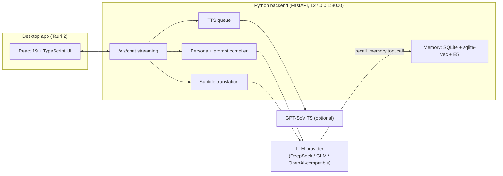

# AMADEUS

**A local-first AI companion desktop app.** Users talk with Amadeus Kurisu, who answers in Japanese with a paired subtitle for every line. Her long-term memory is stored on the user's own machine, where it can be inspected and selectively forgotten.

*Unofficial, non-commercial fan project based on STEINS;GATE. No original game assets are included.* · [中文](#中文) · [日本語](#日本語)

| | |
|---|---|
|  |  |
|  |  |

*Screenshots were taken without the optional asset pack, so the stage shows placeholder art. The worldline-shift frame comes from a transition prototype that is not merged yet; the star map shows test data.*

## What it does

- **Japanese conversation with paired Chinese subtitles.** Replies stream sentence by sentence; each Japanese sentence is matched with its translation, and missing translations are marked instead of silently dropped.
- **Long-term memory that stays local.** Facts from your conversations are stored in SQLite with vector search (sqlite-vec + `multilingual-e5-small`). The model decides when it needs to remember something and calls a `recall_memory` tool; the server scopes the search and returns bounded candidates. You can browse what she remembers and make her forget a conversation.
- **Two isolated worldlines.** *STEINS;GATE* and *β* each have their own persona, conversations, memory and visual theme; no data is shared between them.
- **Bring your own model.** DeepSeek, Zhipu GLM, or any OpenAI-compatible endpoint, including local models. Optional web search through Tavily or Firecrawl.
- **Optional voice.** Text-to-speech through a local GPT-SoVITS server; speech recognition with SenseVoice via sherpa-onnx (backend only for now, no microphone UI yet).
- **Local by design.** Every service binds to loopback, WebSocket connections are origin-checked, and API keys go to the Windows Credential Manager. Conversation text is sent only to the model provider the user configures; if web search is enabled, search queries also go to the chosen search provider (Tavily or Firecrawl).

## Architecture



One chat turn: the UI sends the user's message over a WebSocket; the backend compiles the persona prompt for the active worldline and streams the model's Japanese reply. If the model calls `recall_memory`, the backend searches only that user's memory for the current worldline and identity, then makes a second model call with tools disabled. Each sentence is published as soon as it is complete; its subtitle and (optional) speech follow on their own ordered tracks, so a slow translation never holds back the text and may arrive after the turn has finished.

## Engineering notes

- **Measured recall behaviour.** In a controlled end-to-end run against a real model (`deepseek-flash`), 12 of 12 prompts that needed a stored fact used it, and 4 of 4 control prompts did not call the tool. That result covers that question set and environment only.
- **Windows installer.** The Tauri shell bundles the backend (PyInstaller, with the embedding model cache) into an NSIS installer, starts it on launch, refuses to start if port 8000 is taken, and shuts it down cleanly on exit. It passed a 10-item acceptance checklist on a clean English Windows Server 2022 VM: install, WebView2 bootstrap, real chat, memory write / recall / forget, restart persistence, and an uninstall that keeps user data. It is not published yet, and the packaging scripts are not part of this repository.
- **Tests.** 524 frontend tests (Vitest) pass, with 2 known visual assertions marked as expected failures; the suite is checked across several time zones. The backend has its own pytest suite in `backend/tests/`.

## How it was built

Built and maintained by one developer, who owns the product direction, architecture decisions and acceptance testing. Most of the implementation was written by AI coding agents in small batches. A second agent reviews most batches against their specification before merging; code changes are gated on the test suite, UI changes are checked with screenshots, and installer changes on a clean Windows VM.

## Status

- **Engineering MVP reached.** The Windows installer passed clean-VM acceptance; the developer's own hands-on run is in progress, and there is no public release yet.
- Developed mainly on Windows; the browser dev mode also runs on Linux.
- **Planned:** English and Japanese UI. Kurisu keeps speaking Japanese in every mode; in English mode her lines get English subtitles, and in Japanese mode subtitles are turned off.

## Run it (development)

You need **Python 3.11**, **Node.js 22.13+** (20.19+ on 20.x also works), and an API key for a model provider or a local OpenAI-compatible model.

```bash
git clone https://github.com/meditecnic/AMADEUS.git
cd AMADEUS

# Terminal 1: backend
cd backend
python -m venv .venv
.venv/Scripts/python -m pip install -r requirements.txt   # Linux/macOS: .venv/bin/python
.venv/Scripts/python -m uvicorn app.main:app --host 127.0.0.1 --port 8000

# Terminal 2: UI
cd desktop
npm ci
npm run dev
```

Open http://localhost:1420. The login passphrase is `Gott würfelt nicht`. Then open **系统 → 连接** (System → Connections) in the top-right corner, add your API key and save. Once the connection check passes, the conversation can start. The first run downloads the embedding model used by memory, which takes a few minutes.

The desktop window comes from the installer build, whose packaging scripts and bundled backend are not in this repository; `npm run tauri -- dev` will not start from this checkout (the shell expects a bundled backend and a free port 8000). For development, use the browser at http://localhost:1420.

**Data location (development mode):** `%APPDATA%\Amadeus` on Windows, `~/.amadeus` elsewhere; override with `AMADEUS_DATA_DIR`. The Windows installer build keeps its data under `%LOCALAPPDATA%\com.amadeus.desktop\data\` instead. API keys are stored in the Windows Credential Manager; on other systems they are kept in memory only.

## Voice (optional)

Without voice, her lines simply appear as text.

- **Speech synthesis** uses [GPT-SoVITS](https://github.com/RVC-Boss/GPT-SoVITS) with the voice model [TTS-KurisuMakise](https://huggingface.co/bysq/TTS-KurisuMakise) by bysq (GPT-SoVITS v2pro, Apache-2.0). Weights and reference audio are not included. Put your own reference clips in `voice-pack/ref/` under the data directory (`ref_neutral.wav`, `ref_happy.wav`, `ref_sad.wav` and six more emotions; see `backend/app/config.py`), or point the `AMADEUS_REF_*` variables at them. Start the GPT-SoVITS API locally (default `http://127.0.0.1:9880`, override with `SOVITS_URL`) and set `SOVITS_GPT_WEIGHTS` / `SOVITS_SOVITS_WEIGHTS` to the weight files.
- **Speech recognition** downloads the SenseVoice int8 model (~163 MB) and Silero VAD (~644 KB) from the [sherpa-onnx releases](https://github.com/k2-fsa/sherpa-onnx/releases/tag/asr-models) on first use, verifies fixed SHA-256 hashes, and stores them under `models/speech/` in the data directory. Use `SENSEVOICE_MODEL`, `SENSEVOICE_TOKENS` and `AMADEUS_VAD_MODEL` to point at local copies.

## Original asset pack

This repository contains **no** original game assets (character art, CG, logos, BGM). The app runs without them and shows its own placeholder art. If you have an asset pack, put it in `asset-pack/amadeus-original/` under the data directory (with `manifest.json` at its root) and restart the backend. The pack is distributed separately with its own notice.

## License

The code in this repository is released under the [MIT License](LICENSE). Provider icons on the connections page come from [Lobe Icons](https://github.com/lobehub/lobe-icons) (MIT); provider names and marks belong to their owners. See [third-party notices](THIRD_PARTY_NOTICES.md) for dependency licenses.

STEINS;GATE, STEINS;GATE 0 and their characters, names and original assets belong to MAGES. Inc. and the respective rights holders. This repository does not include those assets and the project is not used for any commercial purpose. If a rights holder asks, we will act on it promptly.

---

## 中文

一个可以在自己电脑上和牧濑红莉栖说话的桌面应用。

她使用日语回答，屏幕上同时有中文字幕。她会记住你们聊过的事，能看得见，也能让她忘掉。（Amadeus 的人格设定基本上就是参考官方小说和相关资料）本项目共有两条世界线：**STEINS;GATE** 和 **β**。两边的对话、记忆互不相通，界面也各是各的样子。（sg 线相当于是架空的，在现实中红莉栖还活着的情况下，诞生的 Amadeus；加了些设定，你在 sg 线提到真实红莉栖，Amadeus 还会争风吃醋。）

这是一个粉丝作品，和官方没有任何关系。

### 现在做到哪了

从 6 月中旬起已经开发了大约四个月。

**新界面的 Windows 安装包已经打出来了**，在一台干净的英文 Windows Server 2022 虚拟机上，10 项验收全部通过：安装、自动装 WebView2、真实对话、记忆的写入/召回/遗忘、重启后还记得、卸载时保留数据。我自己再完整体验一轮，就放出来。（打包脚本不在这个仓库里）

已经能用的：

- 和她用日语多轮对话，中文字幕逐句跟上
- 长期记忆：她记住了什么随时能查，不想让她记得的可以让她忘掉（记忆星图还在打磨，现在先在档案页里看）
- 在 SG 和 β 两条世界线之间跃迁，各自保留会话和草稿
- 接入你自己的大模型：DeepSeek、智谱 GLM，或任何兼容 OpenAI 接口的服务（包括本地模型）
- 可选的联网搜索（Tavily、Firecrawl）
- 用红莉栖的声音念出她的回答（需要另外跑 GPT-SoVITS，见上文 [Voice](#voice-optional)）

接下来：英文和日文界面。她始终说日语；英文界面下配英文字幕，日文界面下就不再显示字幕了。

### 运行

命令见上文 [Run it](#run-it-development)：后端 `uvicorn app.main:app`，界面 `npm run dev`，然后打开 http://localhost:1420 。Windows 和 Linux 都能跑。

**登录口令**是：`Gott würfelt nicht`。（算是原作的一个小彩蛋吧，后续我也会做些调整）

进去以后，从右上角的「系统」打开「连接」，填上你的 API 密钥，保存。连接测试通过后，就可以开始说话了。第一次运行会下载记忆功能要用的模型，稍等一会儿。

开发模式下，对话和记忆放在 `%APPDATA%\Amadeus`（可以用环境变量 `AMADEUS_DATA_DIR` 改到别处）；安装版放在 `%LOCALAPPDATA%\com.amadeus.desktop\data\`。所有服务只监听本机地址，你的对话只会发给你自己配置的那个模型服务；如果开启联网搜索，搜索词还会发给你配置的搜索服务（Tavily 或 Firecrawl）。

### 原作素材包

本仓库**不包含**任何原作素材，比如立绘、CG、Logo、BGM。没有素材包也能正常使用，界面会换成自制画面。（版权问题，目前的解法就只能是素材包了）

### 语音

声音模型是 Hugging Face 上 bysq 训练的 [TTS-KurisuMakise](https://huggingface.co/bysq/TTS-KurisuMakise)。本仓库不附带模型权重和参考音频，需要自己下载。（参考音频我本地是有的，但是考虑到版权的问题，总之，这些阻力，我后续开发都会尽量解决）语音识别的后端已经有了（其实前端页面还没做，哈哈）。

### 个人的碎碎念吧

因为一直是个人开发，中途的困难挫折也有很多，目前最棘手的应该就是版权问题了。之前说尽量在 1 个月左右推送首个 MVP 安装包——安装包已经打好、过了工程验收，等我自己完整体验一轮就放出来。

okeydokey，大概就是这些，那么来句帅气的收尾吧：El Psy Kongroo.

---

## 日本語

> *世界線変動率 1.048596%――Amadeus システム、起動。*

自分の PC の中で、牧瀬紅莉栖と話せるデスクトップアプリだ。

彼女は日本語で答える。交わした言葉の記憶は、機関の目が届かないあなたの PC の中だけに刻まれる。何を覚えているかはいつでも覗けるし、会話ごと忘れさせることもできる。世界線は **STEINS;GATE** と **β** の二つ。会話も記憶も、決して交わらない。（SG 世界線のアマデウスは、オリジナルの紅莉栖が生きている世界で生まれた。本人の話をすると……少し妬くかもしれない）

- 日本語での会話（中国語字幕つき。英語・日本語 UI は開発予定。彼女はどのモードでも日本語で話す――英語モードでは英語字幕、日本語モードでは字幕なし）
- ローカル長期記憶：SQLite + sqlite-vec + multilingual-e5-small。必要なときだけモデルが `recall_memory` ツールで思い出す
- DeepSeek、Zhipu GLM、OpenAI 互換 API（ローカルモデルを含む）に対応
- 音声合成（GPT-SoVITS）は任意

起動方法は [Run it](#run-it-development) を参照。ログインの合言葉は `Gott würfelt nicht`――神はサイコロを振らない。

非公式・非営利のファン作品。原作素材は一切含まない。STEINS;GATE の権利は MAGES. Inc. および各権利者に帰属する。

*El Psy Kongroo.*
