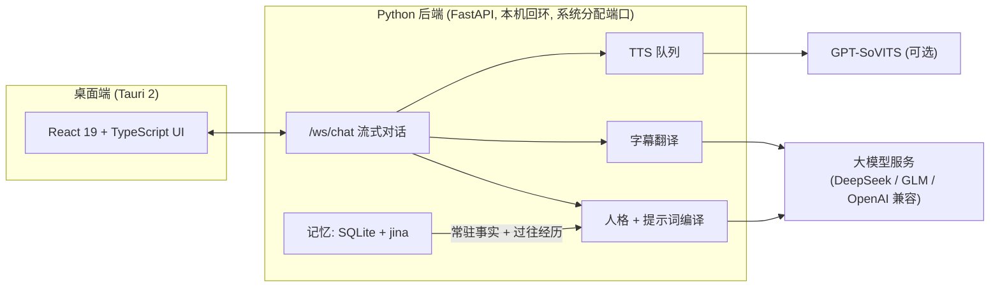

# AMADEUS

**一个可以在自己电脑上和牧濑红莉栖说话的桌面应用。**

她使用日语回答，屏幕上同时有中文字幕。她会记住你们聊过的事，能看得见，也能让她忘掉。（Amadeus 的人格设定基本上就是参考官方小说和相关资料）本项目共有两条世界线：**STEINS;GATE** 和 **β**。两边的对话、记忆互不相通，界面也各是各的样子。（sg 线相当于是架空的，在现实中红莉栖还活着的情况下，诞生的 Amadeus；加了些设定，你在 sg 线提到真实红莉栖，Amadeus 还会争风吃醋。）

这是一个非官方、非商业的粉丝作品，和官方没有任何关系，仓库里也不包含任何原作素材。 · [English](#english) · [日本語](#日本語)

| | |
|---|---|
|  |  |
|  |  |

*截图是在没放原作素材包的情况下截的，所以舞台上是自制的占位画面。世界线跃迁那张是整合进来的 WebGL2 演出，记忆星图里展示的是测试数据。（除了登录页，界面目前正在整体重做，截图等这轮做完再换。）*

## 现在做到哪了

从 6 月中旬起已经开发了大约五个月。一开始没考虑到版权问题，所以另开了这个仓库公开，这里的提交历史比实际开发时间短。

**Windows 安装包已经打出来了**，之前在一台干净的英文 Windows Server 2022 虚拟机上，10 项验收全部通过：安装、自动装 WebView2、真实对话、记忆的写入/召回/遗忘、重启后还记得、卸载时保留数据。现在每次打包还会在 CI 的干净 Windows 机器上自动跑一轮安装冒烟（静默安装、登录页、无密钥本地兼容端点连上 `ONLINE` 且 0 控制台报错、单实例锁、关窗后整棵进程树退干净、检查没有任何外连、静默卸载保留用户数据），建 Release 前也会用仓库里的公钥校验更新包签名。v0.1.0 正在准备，还没有公开发布。（打包脚本在 `packaging/windows/`，冻结后端是构建产物，不进仓库。）

已经能用的：

- **日语对话 + 逐句中文字幕**：按句流式返回，每一句日语都配好对应的中文字幕；就算某句翻译慢了也不会卡住正文，漏翻会明确标出来，不会悄悄丢掉
- **存在本机的长期记忆**：对话里提取的事实和经历都存在本机 SQLite 里（写入时用 768 维的 `jina-embeddings-v5-text-nano-retrieval` 建向量索引）。事实分两类：常驻事实每轮都会放进提示词；按需事实则在需要时由模型调用 `recall_memory` 工具（仅 DeepSeek）去查，跟当前这句匹配上的事实和相关的过往经历也会在编译提示词时一起带上。她记住了什么随时能在档案页里看、改、删，也可以在记忆星图里浏览；清空某段对话时，还能顺便把那段对话独有的长期记忆一起抹掉
- **两条隔离的世界线**：**STEINS;GATE** 和 **β** 各自有独立的人格、会话、记忆和界面主题，两边的数据完全分开存。在右上角「系统 → 世界线」里，仪表盘显示当前世界线，图里预览目标线，按跃迁按钮就能切换，各自保留会话和草稿；演出途中点击或按 Esc 可以跳过动画（仍然会等目标线确认就绪）
- **接入你自己的大模型**：DeepSeek、智谱 GLM，或任何兼容 OpenAI 接口的服务
- **可选的联网搜索**：支持 Tavily、Firecrawl
- **用红莉栖的声音念出她的回答**：通过本机的 GPT-SoVITS 合成语音（可选，见下文「[语音](#语音)」）；基于 sherpa-onnx 的 SenseVoice 语音识别后端也做好了（前端麦克风页面还没做）
- **默认全在本机跑**：所有服务只监听本机回环地址（loopback），WebSocket 连接校验 Origin；安装版把 API 密钥存在 Windows 凭据管理器里，源码运行默认只放内存。你的对话内容只会发给你自己配置的模型服务；如果开了联网搜索，搜索词还会发给你选的搜索服务（Tavily 或 Firecrawl）

目前除了登录页以外的界面正在整体重做，上面的截图等做完再换。英文和日文界面仍在计划中；她始终说日语，英文界面下配英文字幕，日文界面下就不再显示字幕了。

## 架构与工程说明



一轮对话是怎么走的：前端通过 WebSocket 把你的话发给后端；后端取出当前世界线和身份下的常驻事实与相关过往经历，编译进人格提示词，流式生成她的日语回复。如果用的是 DeepSeek，模型可以在需要时调用 `recall_memory` 取回按需事实，再走第二轮生成。每一句日语生成完就立刻发给前端，对应的中文字幕和（可选的）语音在各自有序的轨道上跟上，所以翻译慢一点也不会拖慢正文。

几点工程上的实测与说明：

- **记忆召回实测**：在接入真实模型（`deepseek-flash`）的受控端到端测试里，12 道需要已存事实的题目全部成功调取，4 道对照题全部没有误调工具（仅代表该题集和当时的测试环境）。
- **Windows 安装包与 CI 门禁**：Tauri 外壳把冻结好的 Python 后端（PyInstaller，含嵌入模型缓存）打进 NSIS 安装包，启动时在系统分配的本机回环端口拉起后端，每个数据目录只允许单实例运行，退出时把后端一起关干净。每次打包 CI（`.github/workflows/release.yml`、`packaging/windows/`）都会检查后端在未设置 `AMADEUS_DATA_DIR` 时拒绝启动，跑 `--self-check` 和 `smoke_frozen.py`，再在一台干净的 Windows runner 上跑 `install_smoke.py`（静默安装、注册表与开始菜单快捷方式、登录页与本地无密钥 `OpenAI-compatible` 端点达到 `ONLINE` 且 0 console error、二次启动单实例拦截、关窗后桌面/后端/WebView2 进程树全退、Windows Filtering Platform 与 CDP 核对无外部网络连接、静默卸载保留用户数据）。打 tag 或手动发版时，建草稿 Release 前还会用 `verify_update_signature.py` 对照 `desktop/src-tauri/tauri.conf.json` 里的公钥核验 `.sig` 更新签名和 `latest.json`。
- **怎么开发出来的**：项目由我一个人维护，定产品方向、架构和最终验收；大部分代码由 AI 编程代理按小批次写出，通常由另一家代理对照规格审查后再合并，代码改动过测试套件、界面改动看截图、安装包改动上干净 Windows 环境验。

## 安装

桌面版只支持 **Windows 10/11 x64**。v0.1.0 发布后可从 [GitHub Releases](https://github.com/meditecnic/AMADEUS/releases) 下载安装包；安装包未签名，SmartScreen 提示时点「更多信息 → 仍要运行」。缺少 WebView2 时安装程序会联网安装；语音可选。后端只监听本机回环，端口由系统分配。

## 常见问题

- **SmartScreen 提示未知发布者**：安装包没做 Authenticode 代码签名。弹窗拦截时，先确认安装包是从本仓库的 GitHub Releases 下来的、并且 SHA-256 和 `SHA256SUMS.txt` 对得上，再点「更多信息 → 仍要运行」。（更新包的 Tauri 签名是用来验证更新来源的，替代不了 Windows 的代码签名。）
- **怎么校验下载的安装包（`SHA256SUMS.txt`）**：把 `SHA256SUMS.txt` 和安装包一起下载下来，在 PowerShell 里跑 `Get-FileHash .\Amadeus_<版本>_x64-setup.exe -Algorithm SHA256`，看看算出来的 `Hash` 和 `SHA256SUMS.txt` 里对应那行的 SHA-256 是不是完全一样（大小写无所谓），对上了再装。同版本的其他附件也能用这条命令验。
- **安装时提示或者卡在 WebView2**：安装包里带的是 WebView2 在线引导程序（`embedBootstrapper`）。如果电脑上还没装过 Microsoft Edge WebView2 Runtime，安装程序会联网去下，这时候需要保持联网。
- **日志文件在哪**：安装版的后端日志（`backend-stdout.log`、`backend-stderr.log`，以及启动失败时的 `backend-startup.log`）默认放在 `%LOCALAPPDATA%\com.amadeus.desktop\logs`；如果你设了环境变量 `AMADEUS_DATA_DIR`，日志就会放在 `<AMADEUS_DATA_DIR>\logs`。
- **提 Issue 报问题**：去 [GitHub Issues](https://github.com/meditecnic/AMADEUS/issues) 报 bug 时，**千万别把自己的 API 密钥、令牌或者聊天记录贴上去**。

## 运行（开发模式）

平时改前端或者想先看看样子，用默认的本地 mock 就行；要接真模型聊天，再起真实后端。两种方式都在浏览器里打开 http://localhost:1420 ，浏览器开发模式在 Linux 上也能跑。

```powershell
git clone https://github.com/meditecnic/AMADEUS.git
cd AMADEUS
```

### 默认本地 mock

只需要装 **Node.js 22.13+**（20.x 用 20.19+ 也行），不用装 Python 后端，也不用准备 API 密钥、模型服务或 TTS。

在仓库根目录下打开 PowerShell：

```powershell
cd desktop
npm ci
# 如果之前设过连真实后端的环境变量，先清掉
Remove-Item Env:AMADEUS_DEV_MOCK -ErrorAction SilentlyContinue
npm run dev -- --port 1420 --strictPort
```

打开 http://localhost:1420/?scenario=streaming ，等 USER ID 自动敲完 `Salieri`，用公开的本地测试口令 **`Gott würfelt nicht`** 登录。（算是原作的一个小彩蛋吧，后续我也会做些调整）随便发句话，就能看到三组逐句流式出来的日语和中文字幕。这里的会话和记忆都是假数据，改了也只存在开发服务器内存里，重启就重置。mock 只在开发时生效，不会打进生产构建，`npm run preview` 里也没有。

想看登录失败、空状态、离线、记忆等其他预设场景，可以翻 [场景目录与切换说明](desktop/src/dev-mock/README.md)、[场景 JSON](desktop/src/dev-mock/scenarios/) 和 [浏览器走查说明](desktop/validation/README.md)。

### 真实后端

想跟她真聊，需要再装个 **Python 3.11**，外加一个大模型服务的 API 密钥。先停掉上面的 mock 服务。

Windows 上建虚拟环境之前，先把这两个装好：

1. **Microsoft Visual C++ 2015–2022 Redistributable (x64)**（[下载页](https://learn.microsoft.com/en-us/cpp/windows/latest-supported-vc-redist)，直链 [`vc_redist.x64.exe`](https://aka.ms/vs/17/release/vc_redist.x64.exe)）。干净系统上如果缺 `vcruntime140_1.dll`，`pip install` 和后端启动看着都正常，等到第一次写记忆导 `torch` 时才会爆 `WinError 1114`（`c10.dll` 初始化失败）。
2. **Python 3.11**（[Python 3.11.9 发布页](https://www.python.org/downloads/release/python-3119/)，64 位安装包 [`python-3.11.9-amd64.exe`](https://www.python.org/ftp/python/3.11.9/python-3.11.9-amd64.exe)——3.11.9 是 python.org 上最后一个提供 Windows 安装包的 3.11 版本）。

先在 `backend/` 下建好 `.venv` 并装好依赖（只用做一次）：

```powershell
cd backend
py -3.11 --version
py -3.11 -m venv .venv
.\.venv\Scripts\python.exe -m pip install -r requirements.txt
cd ..
```

装好依赖之后，推荐直接用 `npm run dev:real` 一条命令把后端和前端一起拉起来（`run_dev.bat` 跑的也是同一个启动器）。它会在内存里生成一次性本地 API 令牌传给两边，按 Ctrl+C 或者任意一边退出时两边一起停：

```powershell
# 在仓库根目录下执行；先给开发模式指定一个独立的数据目录（别放在容易被清掉的 TEMP，也别指到正式安装版的数据目录）
$env:AMADEUS_DATA_DIR = Join-Path $env:LOCALAPPDATA 'amadeus-dev-data'
Remove-Item Env:AMADEUS_DB_PATH -ErrorAction SilentlyContinue
cd desktop
npm ci
npm run dev:real
```

如果想手动开两个终端跑（不启用本地 API 令牌认证，后端会打一条仅限开发使用的 WARNING），保持 `AMADEUS_LOCAL_API_TOKEN` 和 `AMADEUS_DEV_LOCAL_API_TOKEN` 不设就行：

终端 1（后端）：

```powershell
cd backend
$env:AMADEUS_DATA_DIR = Join-Path $env:LOCALAPPDATA 'amadeus-dev-data'
Remove-Item Env:AMADEUS_DB_PATH -ErrorAction SilentlyContinue
.\.venv\Scripts\python.exe -m uvicorn app.main:app --host 127.0.0.1 --port 8000
```

终端 2（前端）：

```powershell
cd desktop
$env:AMADEUS_DEV_MOCK = "0"
npm run dev -- --port 1420 --strictPort
```

Linux / macOS 上跑真实后端时，同样先设一个独立的 `AMADEUS_DATA_DIR`（比如 `export AMADEUS_DATA_DIR="$(mktemp -d -t amadeus-dev.XXXXXXXX)"` 并 `unset AMADEUS_DB_PATH`），然后在 `desktop/` 里跑 `npm run dev:real`，或者用两终端方式启动。

打开 http://localhost:1420 ，登录口令还是 `Gott würfelt nicht`（真实后端不区分大小写，`ü` 写成 `u` 或 `ue` 也认）。进去以后，点右上角「**系统 → 连接**」，里面默认有一条 `OpenAI-compatible · http://127.0.0.1:1234/v1 · local-model` 的预设；填上你自己的模型服务配置和 API 密钥并保存，连接测试通过后就可以开始说话了。

第一次写记忆时会自动下载记忆嵌入模型（`jinaai/jina-embeddings-v5-text-nano-retrieval`，fp32，768 维，约 866 MB，Jina AI CC BY-NC 4.0，固定 revision `ac5d898c8d382b17167c33e5c8af644a3519b47d`），稍等一会儿；如果想提前下好（连同带许可声明的模型卡）：

```sh
hf download jinaai/jina-embeddings-v5-text-nano-retrieval --revision ac5d898c8d382b17167c33e5c8af644a3519b47d --include onnx/model.onnx onnx/model.onnx_data tokenizer.json README.md
```

注：桌面独立窗口来自打包出来的安装版，源码仓库里不包含冻结后端产物，所以直接跑 `npm run tauri -- dev` 是起不来的；开发时直接用浏览器访问 http://localhost:1420 即可。

### 数据和日志放在哪

- **安装版**：数据默认放在 `%LOCALAPPDATA%\com.amadeus.desktop\data`。卸载时默认保留数据；如果在卸载向导里勾选删除应用数据，就会把这个默认目录删掉。想换个地方存，可以设置用户环境变量 `AMADEUS_DATA_DIR` 后重启应用。
- **源码运行与单独起后端**：必须显式设置非空的 `AMADEUS_DATA_DIR` 到独立目录，没设或者为空都会直接拒绝启动（不会偷偷回退去读你的个人目录，单设 `AMADEUS_DB_PATH` 也不能绕过）。
- **找不到数据目录时不建空库**：如果配置的数据目录丢失、无效，或者已有的 SQLite 库在启动自检（`PRAGMA quick_check`）时未通过，程序会直接停下报错，不会在原处新建一个空库把问题盖过去。
- **日志位置**：桌面端拉起后端时的日志（`backend-stdout.log`、`backend-stderr.log` 和启动失败时的 `backend-startup.log`）默认在 `%LOCALAPPDATA%\com.amadeus.desktop\logs`；设了 `AMADEUS_DATA_DIR` 时在 `<AMADEUS_DATA_DIR>\logs`。
- **API 密钥存在哪**：Windows 安装版存在 Windows 凭据管理器里；源码运行默认只存内存，重启后重填（Windows 源码运行如果想持久化，可以设 `AMADEUS_CREDENTIAL_BACKEND=windows`，注意这会读写你本机真实的 Windows 凭据）。

## 原作素材包

本仓库**不包含**任何原作素材，比如立绘、CG、Logo、BGM。没有素材包也能正常使用，界面会换成自制画面。（版权问题，目前的解法就只能是素材包了）如果你手头有素材包，放到数据目录下的 `asset-pack/amadeus-original/`（根目录带 `manifest.json`）再重启后端就行。素材包里只有原作相关的内容；应用自己生成的底纹和插画随仓库发布，来源登记在 [assets/PROVENANCE.md](assets/PROVENANCE.md)。

## 语音

语音合成是可选功能，不配语音的话她的台词就直接显示成文字。通过本机的 [GPT-SoVITS](https://github.com/RVC-Boss/GPT-SoVITS) 服务完成，声音模型是 Hugging Face 上 bysq 训练的 [TTS-KurisuMakise](https://huggingface.co/bysq/TTS-KurisuMakise)（GPT-SoVITS v2pro）。本仓库不附带、不下载、也不转发模型权重和参考音频，需要你自己准备。（参考音频我本地是有的，但是考虑到版权的问题，总之，这些阻力，我后续开发都会尽量解决）把你自己的参考音频放进数据目录下的 `voice-pack/ref/`（`ref_neutral.wav`、`ref_happy.wav`、`ref_sad.wav` 等 9 种情绪，见 `backend/app/config.py`，也可以用 `AMADEUS_REF_*` 环境变量指定），在本机起好 GPT-SoVITS API（默认 `http://127.0.0.1:9880`，可用 `SOVITS_URL` 改），并设好 `SOVITS_GPT_WEIGHTS` / `SOVITS_SOVITS_WEIGHTS`。

语音识别的后端已经有了（其实前端页面还没做，哈哈）——第一次用时会从 [sherpa-onnx releases](https://github.com/k2-fsa/sherpa-onnx/releases/tag/asr-models) 下载 SenseVoice int8 模型（约 163 MB）和 Silero VAD（约 644 KB），校验固定 SHA-256 后存在数据目录下的 `models/speech/`（也可用 `SENSEVOICE_MODEL`、`SENSEVOICE_TOKENS`、`AMADEUS_VAD_MODEL` 指向本地文件）。

**关于声音的版权说明**：这个声音模仿的是《命运石之门》里的牧濑红莉栖。角色、原作录音和声优的表演归各自的权利人所有。模型页上的 Apache-2.0 只覆盖上传者自己能授权的部分，不代表获得了角色、原作录音或表演的授权。请只在个人、非商业场景使用，不要用它冒充声优，也不要制作看起来像官方的内容。权利人如需移除相关内容，请在 GitHub 提 issue，我们会尽快处理。

## 许可与声明

本仓库源码使用 [MIT 许可](LICENSE)。连接页上的供应商图标来自 [Lobe Icons](https://github.com/lobehub/lobe-icons)（MIT），各品牌名称与标志归各自所有者所有。安装包内置了 CC BY-NC 4.0 许可的 Jina AI 嵌入模型，因此**安装包整体仅限非商业使用**。语音组件包含 eSpeak NG（GPLv3），对应的源码包 `amadeus-0.1.0-speech-sources.zip` 会随每个版本在 GitHub Releases 一并发布，详见 [第三方说明](THIRD_PARTY_NOTICES.md)。

STEINS;GATE、STEINS;GATE 0 及其角色、名称与原作素材归 MAGES. Inc. 及各自权利人所有。本仓库不包含这些素材，项目也不用于任何商业用途；权利人如有要求，我们会尽快处理。

## 个人的碎碎念吧

因为一直是个人开发，中途的困难挫折也有很多，目前最棘手的应该就是版权问题了。之前说尽量在 1 个月左右推送首个 MVP 安装包——安装包已经打好、过了工程验收，等我自己完整体验一轮就放出来。

okeydokey，大概就是这些，那么来句帅气的收尾吧：El Psy Kongroo.

---

## English

**A local-first AI companion desktop app.** Users talk with Amadeus Kurisu, who answers in Japanese with a paired subtitle for every line. Her long-term memory is stored on the user's own machine, where it can be inspected and selectively forgotten.

*Unofficial, non-commercial fan project based on STEINS;GATE. No original game assets are included.*

### What it does

- **Japanese conversation with paired Chinese subtitles.** Replies stream sentence by sentence; each Japanese sentence is matched with its translation, and missing translations are marked instead of silently dropped.
- **Long-term memory that stays local.** Facts and experiences from your conversations are stored in SQLite (with 768-dimensional `jina-embeddings-v5-text-nano-retrieval` embeddings indexed on write). Facts are split into resident facts, which go into the prompt every turn, and on-demand facts: the model fetches them with the `recall_memory` tool (DeepSeek only) when a turn needs them, and facts that match the current message are added to that turn's prompt. Related past experiences are also added when the prompt is compiled. In the memory archive you can view, correct and delete stored facts and view and delete experiences; you can also optionally erase a conversation's exclusive long-term memories when clearing a chat, and browse memories on the star map.
- **Two isolated worldlines.** *STEINS;GATE* and *β* each have their own persona, conversations, memory and visual theme. Conversations and memories are stored separately per worldline.
- **Worldline transitions.** Switch between worldlines in **系统 → 世界线**: the dial shows the current worldline, the diagram previews the selected target, and the shift button starts the transition while preserving each worldline's conversations and draft. Click or press Esc to skip the transition animation while still waiting for target confirmation.
- **Bring your own model.** DeepSeek, Zhipu GLM, or any OpenAI-compatible endpoint. Optional web search through Tavily or Firecrawl.
- **Optional voice.** Text-to-speech through a local GPT-SoVITS server; speech recognition with SenseVoice via sherpa-onnx (backend only for now, no microphone UI yet).
- **Local by design.** Every service binds to loopback, WebSocket connections are origin-checked, and API keys are stored in the Windows Credential Manager in installed builds or in memory by default in source runs. Conversation text is sent only to the model provider the user configures; if web search is enabled, search queries also go to the chosen search provider (Tavily or Firecrawl).

### Architecture

One chat turn: the UI sends the user's message over a WebSocket; the backend loads the resident facts and related past experiences for the active worldline and identity, compiles them into the persona prompt, and streams the model's Japanese reply. With DeepSeek, the model can call `recall_memory` to fetch on-demand facts, which adds a second model pass. Each sentence is published as soon as it is complete; its subtitle and (optional) speech follow on their own ordered tracks, so a slow translation never holds back the text and may arrive after the turn has finished.

### Engineering notes

- **Measured recall behaviour.** In a controlled end-to-end run against a real model (`deepseek-flash`), 12 of 12 prompts that needed a stored fact used it, and 4 of 4 control prompts did not call the tool. That result covers that question set and environment only.
- **Windows installer.** The Tauri shell bundles the backend (PyInstaller, with the embedding model cache) into an NSIS installer, starts it on a system-assigned loopback port on launch, allows only one instance per data directory, and shuts it down cleanly on exit. Alongside the earlier 10-item acceptance pass on a clean English Windows Server 2022 VM (install, WebView2 bootstrap, real chat, memory write / recall / forget, restart persistence, and an uninstall that keeps user data), every packaging run in CI (`.github/workflows/release.yml`, `packaging/windows/`) checks that the frozen backend refuses to start without `AMADEUS_DATA_DIR`, runs `--self-check` and `smoke_frozen.py`, and runs `install_smoke.py` on a clean Windows runner: silent install (HKCU uninstall registration and Start Menu shortcut), login page and local keyless `OpenAI-compatible` provider reaching `ONLINE` with zero console errors, single-instance lock on a second launch, full desktop/backend/WebView2 process-tree exit on window close, Windows Filtering Platform and CDP checks for no external network connections, and silent uninstall that retains user data. For tagged and manual release builds, `verify_update_signature.py` verifies the `.sig` update signature and `latest.json` against the updater public key in `desktop/src-tauri/tauri.conf.json` before creating a draft Release. No release is published yet; the frozen backend is a build artifact excluded from the repository.

### How it was built

Built and maintained by one developer, who owns the product direction, architecture decisions and acceptance testing. Most of the implementation was written by AI coding agents in small batches. A second agent reviews most batches against their specification before merging; code changes are gated on the test suite, UI changes are checked with screenshots, and installer changes on a clean Windows VM.

### Status

- **v0.1.0 is being prepared.** There is no public release yet.
- **The UI is being reworked across the app** (except the login screen); screenshots will be updated after the rework.
- The desktop app supports **Windows 10/11 x64 only**; the browser dev mode also runs on Linux.
- **Planned:** English and Japanese UI. Kurisu keeps speaking Japanese in every mode; in English mode her lines get English subtitles, and in Japanese mode subtitles are turned off.

### Installation

Once v0.1.0 is published, download the Windows installer from [GitHub Releases](https://github.com/meditecnic/AMADEUS/releases). The installer is unsigned, so Windows SmartScreen will warn; choose **More info → Run anyway** to continue. If WebView2 is missing, the installer downloads and installs it, which requires an internet connection. Voice is optional.

### Troubleshooting

- **Windows SmartScreen warning.** The installer is not Authenticode-signed. When SmartScreen warns about an unknown publisher, verify that the download came from this repository's GitHub Releases and that its SHA-256 matches `SHA256SUMS.txt`, then choose **More info → Run anyway**. (The Tauri update signature verifies update origin and does not replace Windows code signing.)
- **Verify downloads (`SHA256SUMS.txt`).** Download `SHA256SUMS.txt` alongside the installer and run `Get-FileHash .\Amadeus_<version>_x64-setup.exe -Algorithm SHA256` in PowerShell. Compare `Hash` (case-insensitive) with the matching entry in `SHA256SUMS.txt` before installing; other release attachments can be checked with the same command.
- **WebView2 installation.** The installer embeds the Microsoft Edge WebView2 bootstrapper (`embedBootstrapper`). If the WebView2 Runtime is missing on the machine, the installer downloads and installs it, which requires an internet connection.
- **Log files.** Installed builds write backend logs (`backend-stdout.log`, `backend-stderr.log`, and `backend-startup.log` on startup failure) to `%LOCALAPPDATA%\com.amadeus.desktop\logs` by default, or `<AMADEUS_DATA_DIR>\logs` when `AMADEUS_DATA_DIR` is set.
- **Reporting issues.** When opening an issue on [GitHub Issues](https://github.com/meditecnic/AMADEUS/issues), **do not include API keys, tokens, or conversation content**.

### Run it (development)

Choose between the default local mock for frontend work and a real backend for model integration. Both use the browser at http://localhost:1420.

```powershell
git clone https://github.com/meditecnic/AMADEUS.git
cd AMADEUS
```

#### Local mock (default)

You only need **Node.js 22.13+** (20.19+ on 20.x also works). No Python backend, API key, model provider or TTS server is needed.

From the repository root, in PowerShell:

```powershell
cd desktop
npm ci
# Clear a previous real-backend override, if any.
Remove-Item Env:AMADEUS_DEV_MOCK -ErrorAction SilentlyContinue
npm run dev -- --port 1420 --strictPort
```

Open http://localhost:1420/?scenario=streaming. Wait for USER ID to finish typing `Salieri`, then log in with the public local test passphrase **`Gott würfelt nicht`**. Send a message to receive three scripted Japanese/Chinese sentence pairs. Session histories and Memory use synthetic fixtures; edits live in the dev server's memory and reset when it restarts. The browser retains UI preferences and the selected scenario.

The mock handles `/api`, `/ws/chat` (and `/ws`) on the same port 1420 without contacting a backend, provider or TTS server. It is a **development-only** Vite plugin (`apply: 'serve'`); its mock server and selector script are excluded from production builds and are not available in `npm run preview`.

See the [scenario catalog and switching guide](desktop/src/dev-mock/README.md), [scenario JSON files](desktop/src/dev-mock/scenarios/), and [browser evidence walkthrough](desktop/validation/README.md) for login failure, empty, offline, memory and other local checks.

#### Real backend

For real conversations, also install **Python 3.11** and use an API key for a model provider. Stop the mock dev server first.

On Windows, install prerequisites before creating the virtual environment:

1. **Microsoft Visual C++ 2015–2022 Redistributable (x64)** ([download page](https://learn.microsoft.com/en-us/cpp/windows/latest-supported-vc-redist), direct [`vc_redist.x64.exe`](https://aka.ms/vs/17/release/vc_redist.x64.exe)). On a clean system without `vcruntime140_1.dll`, `pip install` and backend startup still succeed, and the failure only surfaces later during the first memory write when importing `torch` raises `WinError 1114` (`c10.dll` initialization failed).
2. **Python 3.11** ([Python 3.11.9 release page](https://www.python.org/downloads/release/python-3119/), 64-bit Windows installer [`python-3.11.9-amd64.exe`](https://www.python.org/ftp/python/3.11.9/python-3.11.9-amd64.exe) — 3.11.9 is the last 3.11 release on python.org that includes Windows binary installers).

Recommended after installing the dependencies: start both processes with one command. The launcher generates a fresh in-memory local API token and passes it to the backend and Vite (never through a `VITE_*` variable). Both processes stop when either exits or you press Ctrl+C.

```powershell
# From the repository root; create backend/.venv and install requirements first.
$env:AMADEUS_DATA_DIR = Join-Path $env:LOCALAPPDATA 'amadeus-dev-data'
Remove-Item Env:AMADEUS_DB_PATH -ErrorAction SilentlyContinue
cd desktop
npm ci
npm run dev:real
```

`AMADEUS_PYTHON` can select a Python executable; the default is `backend/.venv/Scripts/python.exe` on Windows and `backend/.venv/bin/python` on Linux/macOS. On Linux/macOS, set `AMADEUS_DATA_DIR` to a separate development directory, unset `AMADEUS_DB_PATH`, then run `npm run dev:real` from `desktop/`. The launcher refuses an empty data directory and clears the legacy database override. It automatically selects a backend port by default (`BACKEND_PORT` unset or `0`); set `BACKEND_PORT` to 1–65535 to require a fixed port. An occupied fixed port fails startup. `run_dev.bat` now runs the same launcher.

Alternative: two manual terminals, without local API authentication. The backend logs a WARNING that HTTP and WS are unauthenticated and intended only for development. Leave `AMADEUS_LOCAL_API_TOKEN` and `AMADEUS_DEV_LOCAL_API_TOKEN` unset for this alternative.

Terminal 1, from the repository root (PowerShell — use `py -3.11` so another Python on `PATH` is not picked up silently):

```powershell
cd backend
py -3.11 --version
py -3.11 -m venv .venv
.\.venv\Scripts\python.exe -m pip install -r requirements.txt
# Use a separate development directory outside TEMP, which may be cleaned up; never select your installed app's data.
$env:AMADEUS_DATA_DIR = Join-Path $env:LOCALAPPDATA 'amadeus-dev-data'
Remove-Item Env:AMADEUS_DB_PATH -ErrorAction SilentlyContinue
.\.venv\Scripts\python.exe -m uvicorn app.main:app --host 127.0.0.1 --port 8000
```

Terminal 2, from the repository root (PowerShell — skip `npm ci` if you already ran it in Local mock):

```powershell
cd desktop
npm ci
$env:AMADEUS_DEV_MOCK = "0"
npm run dev -- --port 1420 --strictPort
```

`AMADEUS_DEV_MOCK=0` disables the mock and restores Vite's existing `/api`, `/ws` and `/health` proxies to `http://127.0.0.1:8000` (override with `AMADEUS_BACKEND_ORIGIN`). Vite's same-origin `POST /__amadeus/bootstrap` supplies the in-memory token (empty for the manual alternative); packaged builds obtain it from the main window's Tauri command. On Linux/macOS, use `python3.11 -m venv .venv` and `.venv/bin/python` for the backend, and `AMADEUS_DEV_MOCK=0 npm run dev -- --port 1420 --strictPort` for the UI.

Before starting the backend on Linux/macOS, set a separate development directory in that terminal:

```sh
export AMADEUS_DATA_DIR="$(mktemp -d -t amadeus-dev.XXXXXXXX)"
unset AMADEUS_DB_PATH
.venv/bin/python -m uvicorn app.main:app --host 127.0.0.1 --port 8000
```

Source runs (including scripts) refuse data-directory resolution without a nonempty `AMADEUS_DATA_DIR`: `RuntimeError: AMADEUS_DATA_DIR required; set it to an explicit data directory` (exit 1). `AMADEUS_DB_PATH` still takes precedence for database files when a data directory is set; setting it alone does not bypass this check. `run_dev.bat` and `npm run dev:real` clear that legacy override and check the data directory before starting either process; set `AMADEUS_DATA_DIR` before invoking it. A direct `uvicorn --reload` invocation can leave its parent watcher running after the backend child refuses to start. The offline snapshot builder and rehearsal CLIs keep their explicit-path isolation and do not require this variable.

Open http://localhost:1420 and log in with `Gott würfelt nicht` (the real backend normalizes case and treats `ü` / `ue` as `u`, so `gott wurfelt nicht` and `Gott wuerfelt nicht` also work here). Then open **系统 → 连接** (System → Connections) in the top-right corner; the `OpenAI-compatible · http://127.0.0.1:1234/v1 · local-model` item already listed there is the built-in default preset for a local OpenAI-compatible server. Configure your model connection and save; once the connection check passes, the conversation can start. The memory embedding model (`jinaai/jina-embeddings-v5-text-nano-retrieval`, fp32, 768 dimensions, ~866 MB, CC BY-NC 4.0 by Jina AI; revision `ac5d898c8d382b17167c33e5c8af644a3519b47d`) is downloaded and loaded on first use; existing E5 indexes are rebuilt at startup (a failed load keeps chat available with lexical retrieval). Without a voice pack, `[WARN] TTS reference audio not found ...` lines in the backend log are normal; voice remains optional (see [Voice](#voice-optional)).

To prefetch the pinned model (including its model card with the license declaration):

```sh
hf download jinaai/jina-embeddings-v5-text-nano-retrieval --revision ac5d898c8d382b17167c33e5c8af644a3519b47d --include onnx/model.onnx onnx/model.onnx_data tokenizer.json README.md
```

The desktop window comes from the installer build; its packaging scripts are in `packaging/windows/`, and the frozen backend is a build artifact excluded from the repository; `npm run tauri -- dev` will not start from this checkout (the shell expects a bundled backend). For development, use the browser at http://localhost:1420.

#### Data location

The Windows installer stores data in `%LOCALAPPDATA%\com.amadeus.desktop\data`. Uninstalling keeps data by default; selecting the uninstaller's option to delete app data removes this default directory. To use another location, set the user environment variable `AMADEUS_DATA_DIR` and restart the app. Source runs and standalone runs of `amadeus-backend.exe` require a nonempty `AMADEUS_DATA_DIR` and refuse to start without it; there is no fallback data directory. If a configured data directory is missing or invalid, or if existing databases fail startup checks, startup stops instead of creating an empty database. Desktop backend logs (`backend-stdout.log`, `backend-stderr.log`, and `backend-startup.log` when startup fails) are written to `%LOCALAPPDATA%\com.amadeus.desktop\logs` by default, or `<AMADEUS_DATA_DIR>\logs` when `AMADEUS_DATA_DIR` is set.

Installed Windows builds store API keys in the Windows Credential Manager; source runs keep them only in memory by default, so re-enter them after each restart. To persist keys from a source run on Windows, set `AMADEUS_CREDENTIAL_BACKEND=windows`; this accesses your real Windows credentials. Other systems keep keys in memory only. The local mock does not use these backend data stores.

### Voice (optional)

Without voice, her lines simply appear as text.

- **Speech synthesis** uses [GPT-SoVITS](https://github.com/RVC-Boss/GPT-SoVITS) with the voice model [TTS-KurisuMakise](https://huggingface.co/bysq/TTS-KurisuMakise) by bysq (GPT-SoVITS v2pro, Apache-2.0). Weights and reference audio are not included. Put your own reference clips in `voice-pack/ref/` under the data directory (`ref_neutral.wav`, `ref_happy.wav`, `ref_sad.wav` and six more emotions; see `backend/app/config.py`), or point the `AMADEUS_REF_*` variables at them. Start the GPT-SoVITS API locally (default `http://127.0.0.1:9880`, override with `SOVITS_URL`) and set `SOVITS_GPT_WEIGHTS` / `SOVITS_SOVITS_WEIGHTS` to the weight files.
- **Speech recognition** downloads the SenseVoice int8 model (~163 MB) and Silero VAD (~644 KB) from the [sherpa-onnx releases](https://github.com/k2-fsa/sherpa-onnx/releases/tag/asr-models) on first use, verifies fixed SHA-256 hashes, and stores them under `models/speech/` in the data directory. Use `SENSEVOICE_MODEL`, `SENSEVOICE_TOKENS` and `AMADEUS_VAD_MODEL` to point at local copies.

**About the voice.** TTS-KurisuMakise imitates the voice of Makise Kurisu from STEINS;GATE. The character, the original recordings and the voice actor's performance belong to their respective rights holders. The Apache-2.0 label on the model page covers only what its uploader can license; it does not grant any rights to the character, the original recordings or the performance. AMADEUS does not include, download or redistribute the model or any reference audio. Use the voice for personal, non-commercial purposes only, and do not use it to impersonate the voice actor or to make content that looks official. Rights holders who want this reference removed can open a GitHub issue; we will respond promptly.

### Original asset pack

This repository contains **no** original game assets (character art, CG, logos, BGM). The app runs without them and shows its own placeholder art. If you have an asset pack, put it in `asset-pack/amadeus-original/` under the data directory (with `manifest.json` at its root) and restart the backend. The pack is distributed separately with its own notice. The pack holds only material from the original work; the app's own generated textures and illustrations ship in this repository and are listed in [assets/PROVENANCE.md](assets/PROVENANCE.md).

### License

The code in this repository is released under the [MIT License](LICENSE). Provider icons on the connections page come from [Lobe Icons](https://github.com/lobehub/lobe-icons) (MIT); provider names and marks belong to their owners. The installer bundles the Jina AI embedding model under CC BY-NC 4.0, so the installer as a whole is for **non-commercial use only**. Speech components include eSpeak NG (GPLv3); the corresponding source package, `amadeus-0.1.0-speech-sources.zip`, will accompany each version on GitHub Releases. See [third-party notices](THIRD_PARTY_NOTICES.md) for details.

STEINS;GATE, STEINS;GATE 0 and their characters, names and original assets belong to MAGES. Inc. and the respective rights holders. This repository does not include those assets and the project is not used for any commercial purpose. If a rights holder asks, we will act on it promptly.

---

## 日本語

> *世界線変動率 1.048596%――Amadeus システム、起動。*

自分の PC の中で、牧瀬紅莉栖と話せるデスクトップアプリだ。

彼女は日本語で答える。交わした言葉の記憶は、機関の目が届かないあなたの PC の中だけに刻まれる。何を覚えているかはいつでも覗けるし、会話ごと忘れさせることもできる。世界線は **STEINS;GATE** と **β** の二つ。会話も記憶も、決して交わらない。（SG 世界線のアマデウスは、オリジナルの紅莉栖が生きている世界で生まれた。本人の話をすると……少し妬くかもしれない）

- 日本語での会話（中国語字幕つき。英語・日本語 UI は開発予定。彼女はどのモードでも日本語で話す――英語モードでは英語字幕、日本語モードでは字幕なし）
- ローカル長期記憶：SQLite + jina-embeddings-v5-text-nano-retrieval（Jina AI、fp32・768 次元、CC BY-NC 4.0、revision `ac5d898c8d382b17167c33e5c8af644a3519b47d`。事前取得には上記の `hf download` コマンドを使用）。事実は常駐と必要時の二種類。常駐の事実は毎ターンプロンプトに入り、それ以外は必要なときだけモデルが `recall_memory` ツール（DeepSeek のみ）で思い出す。記憶アーカイブで閲覧・修正・削除できる
- DeepSeek、Zhipu GLM、OpenAI 互換 API（ローカルモデルを含む）に対応
- 音声合成（GPT-SoVITS）は任意

この音声は『STEINS;GATE』の牧瀬紅莉栖の声を模倣したものです。キャラクター、原作の録音、声優の実演に関する権利は、それぞれの権利者に帰属します。モデルページの Apache-2.0 は、アップロードした本人が許諾できる範囲にのみ適用され、キャラクター、原作の録音、実演に関する権利の許諾を意味するものではありません。個人かつ非商用の用途に限って使用し、声優へのなりすましや、公式と誤認されるようなコンテンツの制作には使わないでください。権利者の方が関連内容の削除を希望される場合は、GitHub で issue を作成してください。速やかに対応します。

UI はログイン画面を除いて全面的に作り直しているところで、スクリーンショットは完了後に差し替える。

デスクトップ版は **Windows 10/11 x64 のみ**に対応し、v0.1.0 は公開準備中で、まだ公開リリースはない。公開後は [GitHub Releases](https://github.com/meditecnic/AMADEUS/releases) からインストーラーを入手できる。署名がないため SmartScreen の警告が出るので、「詳細情報 → 実行」を選ぶ。WebView2 がなければインストーラーがネット経由で導入する。音声は任意。バックエンドはループバックのみで待ち受け、ポートはシステムが割り当てる。ブラウザーでの開発モードは Linux でも動く。

コードは MIT。インストーラーには CC BY-NC 4.0 の jina 埋め込みモデルが含まれるため、インストーラー全体は非商用利用に限る。音声コンポーネントには eSpeak NG（GPLv3）が含まれ、対応するソース `amadeus-0.1.0-speech-sources.zip` は各バージョンと一緒に Releases で公開する。詳細は [第三者ライセンス](THIRD_PARTY_NOTICES.md) を参照。

### よくある質問

- **SmartScreen の警告**：インストーラーには Authenticode 署名がない。SmartScreen が未知の発行元を警告した場合は、このリポジトリの GitHub Releases から取得したことと `SHA256SUMS.txt` のハッシュ一致を確認してから「詳細情報 → 実行」を選ぶ（更新パッケージの Tauri 署名は更新元の検証用であり、Windows のコード署名の代わりにはならない）。
- **ダウンロードの検証（`SHA256SUMS.txt`）**：`SHA256SUMS.txt` とインストーラーをダウンロードし、PowerShell で `Get-FileHash .\Amadeus_<バージョン>_x64-setup.exe -Algorithm SHA256` を実行する。`Hash` を `SHA256SUMS.txt` の該当ファイルの SHA-256 と（大文字・小文字を区別せず）比較し、完全一致を確認してから導入する。他の添付ファイルも同じコマンドで検証できる。
- **WebView2 の導入**：インストーラーは WebView2 のオンラインブートストラッパー（`embedBootstrapper`）を内蔵している。Microsoft Edge WebView2 Runtime が未導入の環境ではネット経由でダウンロード・導入するため、インターネット接続が必要になる。
- **ログの場所**：インストール版のバックエンドログ（`backend-stdout.log`、`backend-stderr.log`、起動失敗時の `backend-startup.log`）は標準で `%LOCALAPPDATA%\com.amadeus.desktop\logs` に出力される。`AMADEUS_DATA_DIR` を設定している場合は `<AMADEUS_DATA_DIR>\logs` に出力される。
- **不具合の報告**：[GitHub Issues](https://github.com/meditecnic/AMADEUS/issues) で問題を報告する際は、**API キー、トークン、会話内容は貼らないこと**。

開発時の起動方法は [运行（开发模式）](#运行开发模式) / [Run it](#run-it-development) を参照。**標準はローカル mock** で、Node.js だけで動き、Python バックエンド、API キー、実際のモデルや TTS は不要。[Local mock](#local-mock-default) の手順で `npm ci` と `npm run dev -- --port 1420 --strictPort` を実行し、http://localhost:1420/?scenario=streaming を開く。USER ID が `Salieri` と入力されるまで待ち、公開のローカルテスト用合言葉 `Gott würfelt nicht` でログインする。メッセージを送ると、日本語と中国語字幕の組が三つ、順番に届く。会話と記憶はテストデータで、開発サーバーの再起動でリセットされる。mock は開発専用で、製品ビルドには含まれず、`npm run preview` でも利用できない。

利用できる状態は [シナリオ一覧と切り替え方法](desktop/src/dev-mock/README.md) と [JSON ファイル](desktop/src/dev-mock/scenarios/)、確認手順は [ブラウザー検証ガイド](desktop/validation/README.md) を参照。

**実際のバックエンドを使う場合**は [Real backend](#real-backend) に従って Python サーバーを起動し、フロントエンド側の PowerShell で `$env:AMADEUS_DEV_MOCK = "0"` を設定してから Vite を起動する。合言葉は同じ `Gott würfelt nicht`――神はサイコロを振らない。ログイン後、右上の「系统 → 连接」で自分のモデル接続を設定する。初回の記憶書き込み時に記憶用の埋め込みモデルがダウンロードされる。音声は任意。

インストール版のデータは `%LOCALAPPDATA%\com.amadeus.desktop\data` に保存され、アンインストール時は標準で保持される（アプリデータ削除を選ぶとこのディレクトリも削除される）。保存先はユーザー環境変数 `AMADEUS_DATA_DIR` を設定してアプリを再起動すると変更でき、ソース実行とバックエンド実行ファイルの単独起動ではこの変数が空または未設定なら起動を拒否する。

非公式・非営利のファン作品。原作素材は一切含まない。STEINS;GATE の権利は MAGES. Inc. および各権利者に帰属する。

*El Psy Kongroo.*
