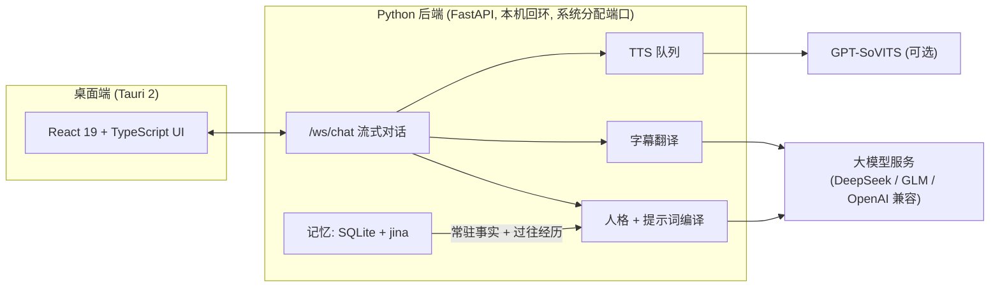

# AMADEUS

**一个可以在自己电脑上和牧濑红莉栖说话的桌面应用。**

她使用日语回答，屏幕上同时有中文字幕。她会记住你们聊过的事，能看得见，也能让她忘掉。（Amadeus 的人格设定基本上就是参考官方小说和相关资料）本项目共有两条世界线：**STEINS;GATE** 和 **β**。两边的对话、记忆互不相通，界面也各是各的样子。（sg 线相当于是架空的，在现实中红莉栖还活着的情况下，诞生的 Amadeus；加了些设定，你在 sg 线提到真实红莉栖，Amadeus 还会争风吃醋。）

这是一个非官方、非商业的粉丝作品，和官方没有任何关系，仓库里也不包含任何原作素材。 · [English](#english) · [日本語](#日本語)

| | |
|---|---|
|  |  |
|  |  |

*截图是没放原作素材包时截的，所以舞台上是自制的占位画面，记忆星图里是测试数据。除了登录页，界面正在整体重做，做完再换新截图。*

## 现在做到哪了

从 6 月中旬开始，做了大约五个月。

**Windows 安装包已经打出来了**，在一台干净的 Windows Server 2022 虚拟机上跑过完整的 10 项验收（安装、对话、记忆、重启、卸载保留数据这些）。现在每次打包，CI 也会在干净的 Windows 上自动装一遍、查一遍。v0.1.0 正在做最后的准备，还没公开发布。

现在能用的：

- **日语对话 + 中文字幕**：回复一句一句流出来，每句日语配一句中文。翻译慢了不会卡住正文，漏翻了会标出来。
- **长期记忆**：存在你自己电脑上。她记了什么，在档案页里都能看、能改、能删，也能在记忆星图里整个逛一逛；清空某段对话时，可以把只属于那段对话的记忆一起抹掉。
- **两条世界线**：**STEINS;GATE** 和 **β** 各有各的人格、会话、记忆和界面风格，对话和记忆分开存（模型连接设置两边共用）。在右上角「**系统 → 世界线**」切换，两边的会话和没发出去的草稿都会留着；跃迁动画不想看，点一下或按 Esc 就能跳过。
- **用你自己的模型**：DeepSeek、智谱 GLM，或者任何兼容 OpenAI 接口的服务（本地跑的也行）。联网搜索可选 Tavily 或 Firecrawl。
- **红莉栖的声音（可选）**：用本机的 GPT-SoVITS 念出来，见「[语音](#语音可选)」。
- **只在本机跑**：服务只监听本机回环地址。对话内容只发给你自己配的模型服务；开了联网搜索的话，搜索词会发给你选的搜索服务。

以后还会做英文和日文界面。不管哪种界面她都说日语：英文界面配英文字幕，日文界面就不显示字幕了。

## 技术细节



- **一轮对话**：前端通过 WebSocket 把你的话发给后端；后端取出当前世界线的常驻事实、和这句话对得上的事实以及相关的过往经历，编进人格提示词，再流式请求日语回复。用 DeepSeek 时，模型觉得要翻旧事，会调 `recall_memory` 工具把其余的事实找出来，再生成一遍。每句日语一写完就推给前端，字幕和语音各走各的队列，所以翻译慢了不拖正文，字幕晚到的话会在这一轮结束后补上。
- **记忆**：事实和经历存在本机 SQLite，写入时用 `jina-embeddings-v5-text-nano-retrieval`（768 维）建向量索引；嵌入模型加载失败时退回关键词检索，聊天不受影响。
- **召回实测**：接真实模型（`deepseek-flash`）的端到端测试里，12 道要用到旧事实的题全都调了记忆，4 道不需要的对照题一次也没误调。只代表那套题和那次的环境。
- **安装包**：Tauri 外壳把 PyInstaller 打包的后端（带嵌入模型）一起装进 NSIS 安装程序；启动时在系统分配的本机端口拉起后端，一个数据目录只开一个实例，关窗口时后端一起退出。每次打包，CI（`.github/workflows/release.yml`、`packaging/windows/`）会先自检打包好的后端，再在干净的 Windows 上跑 `install_smoke.py`：静默安装、登录并连上本地模型端点、单实例、关窗后进程全部退出、没有任何对外网络连接、卸载后数据还在。发版前还会用 `verify_update_signature.py` 核对自动更新的签名。
- **安全**：WebSocket 会校验 Origin。安装版的 API 密钥存在 Windows 凭据管理器里，源码运行默认只放在内存里。
- **怎么开发的**：这个项目由我一个人维护，产品方向、架构取舍和最终验收都是我自己在管。代码大多由 AI 编程代理分小批写，合并前一般会让另一个代理对着规格审一遍；代码改动要过测试，界面改动看实机截图，安装包改动上干净的 Windows 跑一遍。

## 安装与常见问题

桌面版只支持 **Windows 10/11（64 位）**。v0.1.0 发布后，从 [GitHub Releases](https://github.com/meditecnic/AMADEUS/releases) 下载安装包。

- **SmartScreen 提示「未知发布者」**：个人项目，还没买代码签名证书。确认是从本仓库 Releases 下载的、校验和也对得上（见下一条），点「**更多信息 → 仍要运行**」就行。
- **核对安装包**：发布页附了 `SHA256SUMS.txt`。在 PowerShell 里跑 `Get-FileHash .\Amadeus_<版本>_x64-setup.exe -Algorithm SHA256`，和文件里对应那一行比一下（不分大小写），一致再装。
- **WebView2**：电脑上还没有 WebView2 运行时的话，安装程序会自动联网装上，这时要连着网。
- **日志在哪**：`%LOCALAPPDATA%\com.amadeus.desktop\logs`；设了 `AMADEUS_DATA_DIR` 的话在 `<AMADEUS_DATA_DIR>\logs`。
- **提 Bug**：欢迎来 [GitHub Issues](https://github.com/meditecnic/AMADEUS/issues) 反馈！贴日志和截图前看一眼，**别把 API 密钥、令牌和聊天内容贴出来**。

## 本地开发运行

两种跑法，都是在浏览器里打开 http://localhost:1420（Linux 上也能跑）：只看界面用**本地 mock**，想真聊就起**真实后端**。

```powershell
git clone https://github.com/meditecnic/AMADEUS.git
cd AMADEUS
```

### 1. 只看界面（本地 mock）

只要 **Node.js 22.13+**（20.x 的话要 20.19+），不用 Python、API 密钥、模型和语音。在仓库根目录下：

```powershell
cd desktop
npm ci
# 之前设过连真实后端的变量的话，先清掉
Remove-Item Env:AMADEUS_DEV_MOCK -ErrorAction SilentlyContinue
npm run dev -- --port 1420 --strictPort
```

打开 http://localhost:1420/?scenario=streaming ，等 USER ID 自动打完 `Salieri`，用公开的本地测试口令 **`Gott würfelt nicht`** 登录。（算是原作的一个小彩蛋吧，后续我也会做些调整）发一句话，会收到三组预设的日语回复和中文字幕。会话和记忆都是测试数据，改了也只存在开发服务器的内存里，重启就还原。

mock 只在开发服务器里有，打生产包时会被剔除。登录失败、空状态、离线、记忆档案等其他场景见 [场景说明](desktop/src/dev-mock/README.md)、[场景文件](desktop/src/dev-mock/scenarios/) 和 [浏览器走查说明](desktop/validation/README.md)。

### 2. 接模型真聊（真实后端）

还需要 **Python 3.11** 和一个大模型服务的 API 密钥。先把 mock 那个开发服务器停掉。

Windows 上先装好这两样：

1. **Visual C++ 2015–2022 运行库 (x64)**（[`vc_redist.x64.exe`](https://aka.ms/vs/17/release/vc_redist.x64.exe)）。缺了它，装依赖和启动后端都不报错，要等第一次写记忆、加载 `torch` 时才报 `WinError 1114`，很难查。
2. **Python 3.11**（[3.11.9](https://www.python.org/downloads/release/python-3119/)，python.org 上最后一个带 Windows 安装包的 3.11 版本）。

建虚拟环境、装依赖（只用做一次）：

```powershell
cd backend
py -3.11 -m venv .venv
.\.venv\Scripts\python.exe -m pip install -r requirements.txt
cd ..
```

然后一条命令同时起前后端（`run_dev.bat` 也是同一个启动器）：

```powershell
# 在仓库根目录；开发单独用一个数据目录，别指向安装版的数据
$env:AMADEUS_DATA_DIR = Join-Path $env:LOCALAPPDATA 'amadeus-dev-data'
Remove-Item Env:AMADEUS_DB_PATH -ErrorAction SilentlyContinue
cd desktop
npm ci
npm run dev:real
```

启动器会临时生成一个本地 API 令牌交给前后端，任意一边退出或者按 Ctrl+C，两边一起停。后端端口默认自动挑空闲的，想固定就设 `BACKEND_PORT`。Linux/macOS 一样：设好 `AMADEUS_DATA_DIR`、`unset AMADEUS_DB_PATH`，在 `desktop/` 下跑 `npm run dev:real`。

想分两个终端、自己看日志也行。这样不开本地令牌认证（`AMADEUS_LOCAL_API_TOKEN`、`AMADEUS_DEV_LOCAL_API_TOKEN` 都别设），只适合调试：

```powershell
# 终端 1：后端（仓库根目录下）
cd backend
$env:AMADEUS_DATA_DIR = Join-Path $env:LOCALAPPDATA 'amadeus-dev-data'
Remove-Item Env:AMADEUS_DB_PATH -ErrorAction SilentlyContinue
.\.venv\Scripts\python.exe -m uvicorn app.main:app --host 127.0.0.1 --port 8000
```

```powershell
# 终端 2：前端（仓库根目录下）
cd desktop
$env:AMADEUS_DEV_MOCK = "0"
npm run dev -- --port 1420 --strictPort
```

`AMADEUS_DEV_MOCK=0` 会关掉 mock，把 `/api`、`/ws` 和 `/health` 转给 `http://127.0.0.1:8000`（`AMADEUS_BACKEND_ORIGIN` 可改）。Linux/macOS 上后端用 `.venv/bin/python`，前端跑 `AMADEUS_DEV_MOCK=0 npm run dev -- --port 1420 --strictPort`。

源码运行一定要设非空的 `AMADEUS_DATA_DIR`，没有默认目录，没设会直接报错退出；只设 `AMADEUS_DB_PATH` 绕不过去。

起来以后打开 http://localhost:1420 ，还是用 `Gott würfelt nicht` 登录（真实后端不分大小写，`ü` 写成 `u` 或 `ue` 也行）。点右上角「**系统 → 连接**」，填好你的模型和 API 密钥并保存，连接测试通过就能聊了。列表里默认那条 `OpenAI-compatible · http://127.0.0.1:1234/v1 · local-model` 是给本地模型服务准备的预设。

第一次写记忆时，会自动下载嵌入模型 `jinaai/jina-embeddings-v5-text-nano-retrieval`（约 866 MB，Jina AI，CC BY-NC 4.0）。想提前下好固定的版本：

```sh
hf download jinaai/jina-embeddings-v5-text-nano-retrieval --revision ac5d898c8d382b17167c33e5c8af644a3519b47d --include onnx/model.onnx onnx/model.onnx_data tokenizer.json README.md
```

没配语音的话，后端日志里的 `[WARN] TTS reference audio not found ...` 不用管。

桌面窗口要靠安装包（打包脚本在 `packaging/windows/`）；源码里直接跑 `npm run tauri -- dev` 起不来，开发就用浏览器。

### 3. 数据、日志和密钥

- **数据**：安装版存在 `%LOCALAPPDATA%\com.amadeus.desktop\data`。卸载默认保留数据，只有在卸载时勾了删除应用数据才会删。想换位置，设用户环境变量 `AMADEUS_DATA_DIR` 再重启应用。
- **数据出问题时**：设的数据目录找不到或者无效，启动会直接停下提示，不会新建空库盖过去。已有的库没通过启动自检（`PRAGMA quick_check`），也不会新建空库，而是进入「数据异常」状态：对话等功能暂停，原来的库原样留着。升级时数据迁移失败，会先退回升级前的备份。
- **日志**：见上面「[安装与常见问题](#安装与常见问题)」。
- **密钥**：安装版存在 Windows 凭据管理器里；源码运行默认只放内存，重启后要重新填。在 Windows 上跑源码也想存下来，可以设 `AMADEUS_CREDENTIAL_BACKEND=windows`（会读写你本机真实的凭据）。

## 原作素材包

仓库里**没有**任何原作素材（立绘、CG、Logo、BGM 这些）。没有素材包也能用，界面会显示自制的占位画面。（版权问题，目前的解法就只能是素材包了）

有素材包的话，放到数据目录下的 `asset-pack/amadeus-original/`（根目录要有 `manifest.json`），重启应用就行。素材包单独分发，里面只有原作素材；应用自己生成的底纹和插画随仓库发布，来源登记在 [assets/PROVENANCE.md](assets/PROVENANCE.md)。

## 语音（可选）

不配语音的话，她的台词就只以文字和字幕出现。

- **语音合成**：用本机的 [GPT-SoVITS](https://github.com/RVC-Boss/GPT-SoVITS)，声音模型推荐 bysq 训练的 [TTS-KurisuMakise](https://huggingface.co/bysq/TTS-KurisuMakise)（GPT-SoVITS v2pro，Apache-2.0）。仓库不带也不下载权重和参考音频，要自己准备：参考音频放进数据目录下的 `voice-pack/ref/`（`ref_neutral.wav`、`ref_happy.wav` 等 9 种情绪，完整列表见 `backend/app/config.py`，也可以用 `AMADEUS_REF_*` 逐个指定），起好 GPT-SoVITS 的 API 服务（默认 `http://127.0.0.1:9880`，`SOVITS_URL` 可改），再把 `SOVITS_GPT_WEIGHTS` 和 `SOVITS_SOVITS_WEIGHTS` 指向权重文件。
- **语音识别**：后端已经接好了（其实前端麦克风页面还没做，哈哈）。第一次用时会从 [sherpa-onnx releases](https://github.com/k2-fsa/sherpa-onnx/releases/tag/asr-models) 下载 SenseVoice int8（约 163 MB）和 Silero VAD 模型，核对 SHA-256 后存在数据目录的 `models/speech/`；也可以用 `SENSEVOICE_MODEL`、`SENSEVOICE_TOKENS` 和 `AMADEUS_VAD_MODEL` 指向本地已有的文件。

**关于声音的版权**：TTS-KurisuMakise 模仿的是《命运石之门》里牧濑红莉栖的声音。角色本身、原作录音以及声优的表演均归各自的权利人所有。模型页面上标注的 Apache-2.0 许可只覆盖上传者自己有权授权的部分，并不代表授予了角色、原作录音或声优表演的任何权利。AMADEUS 不会内置、下载或分发该模型及任何参考音频。请仅在个人、非商业场景下使用，不要用它去冒充声优本人，也不要制作让人误以为是官方出品的内容。权利人如果希望移除相关引用或内容，请在 GitHub 上提一个 issue，我们会第一时间处理。

## 许可与声明

代码采用 [MIT 许可](LICENSE)。连接设置页上的模型供应商图标来自 [Lobe Icons](https://github.com/lobehub/lobe-icons)（MIT），各供应商的名称与商标归各自所有者所有。安装程序内置了 CC BY-NC 4.0 许可的 Jina AI 嵌入模型，所以**安装包整体仅限非商业使用**。语音组件包含 eSpeak NG（GPLv3），对应的源码包 `amadeus-0.1.0-speech-sources.zip` 会随每个版本在 GitHub Releases 一并提供，详见 [第三方说明](THIRD_PARTY_NOTICES.md)。

STEINS;GATE、STEINS;GATE 0 及其角色、名称与原作素材均归 MAGES. Inc. 及各自权利人所有。本仓库不包含这些原作素材，项目也不用于任何商业用途；权利人如有任何要求，我们会尽快配合处理。

## 个人的碎碎念吧

因为一直是个人开发，中途的困难挫折也有很多，目前最棘手的应该就是版权问题了。之前说尽量在 1 个月左右推送首个 MVP 安装包——安装包已经打好、过了工程验收，等我自己完整体验一轮就放出来。

okeydokey，大概就是这些，那么来句帅气的收尾吧：El Psy Kongroo.

---

## English

**A desktop app for talking with Makise Kurisu on your own computer.** She answers in Japanese with a paired subtitle for every line, and her long-term memory stays on your machine, where you can inspect it and make her forget.

*Unofficial, non-commercial fan project based on STEINS;GATE. No original game assets are included.*

### What it does

- **Japanese conversation with Chinese subtitles.** Replies stream sentence by sentence, each paired with its translation. A slow translation never holds back the text, and a missing one is marked instead of dropped.
- **Local long-term memory.** View, correct and delete what she remembers in the memory archive, or browse it on the star map. When clearing a chat, you can also erase the memories that only that chat produced.
- **Two worldlines.** *STEINS;GATE* and *β* each have their own persona, conversations, memory and look. Conversations and memories are stored separately; model connection settings are shared. Switch in **系统 → 世界线** (System → Worldline); each side keeps its conversations and unsent draft. Click or press Esc to skip the transition.
- **Bring your own model.** DeepSeek, Zhipu GLM, or any OpenAI-compatible endpoint, including local ones. Optional web search through Tavily or Firecrawl.
- **Optional voice.** Text-to-speech through a local GPT-SoVITS server (see [Voice](#voice-optional)).
- **Local by design.** Services bind to loopback only. Conversation text goes only to the model provider you configure; with web search on, search queries also go to the search provider you chose.

**Status:** v0.1.0 is being prepared; there is no public release yet. The installer passed a 10-item acceptance run on a clean Windows Server 2022 VM. The UI is being reworked (except the login screen), so screenshots will change. English and Japanese UIs are planned; she always speaks Japanese, with English subtitles in English mode and none in Japanese mode.

### Under the hood

- **One chat turn.** The UI sends your message over a WebSocket. The backend loads the active worldline's resident facts, facts that match the message, and related past experiences into the persona prompt, then streams the Japanese reply. With DeepSeek, the model can call `recall_memory` to fetch other facts, which adds a second model pass. Each sentence is sent as soon as it is complete; subtitles and speech follow on their own queues and may arrive after the turn ends.
- **Memory.** Facts and experiences live in local SQLite, embedded on write with `jina-embeddings-v5-text-nano-retrieval` (768 dimensions). If the embedding model fails to load, retrieval falls back to keyword matching and chat keeps working.
- **Measured recall.** In an end-to-end run against a real model (`deepseek-flash`), 12 of 12 prompts that needed a stored fact used it, and 4 of 4 control prompts did not call the tool. That result covers that question set and environment only.
- **Installer.** The Tauri shell bundles the PyInstaller backend (with the embedding model) into an NSIS installer, starts it on a system-assigned loopback port, allows one instance per data directory and stops it on exit. Every packaging run in CI (`.github/workflows/release.yml`, `packaging/windows/`) self-checks the frozen backend, then runs `install_smoke.py` on a clean Windows runner: silent install, login and a local model endpoint going online, single instance, full process exit on close, no external network connections, and an uninstall that keeps user data. Release builds also verify the update signature with `verify_update_signature.py`.
- **Security.** WebSocket connections are origin-checked. Installed builds keep API keys in the Windows Credential Manager; source runs keep them in memory by default.
- **How it was built.** One developer owns the product direction, architecture and acceptance testing. Most code is written by AI coding agents in small batches, and a second agent usually reviews each batch against its specification. Code changes must pass the test suite, UI changes are checked with screenshots, and installer changes on a clean Windows machine.

### Install and troubleshooting

The desktop app supports **Windows 10/11 x64 only**. Once v0.1.0 is out, download it from [GitHub Releases](https://github.com/meditecnic/AMADEUS/releases).

- **SmartScreen warning.** The installer is not code-signed. Check that it came from this repository's Releases and that its hash matches `SHA256SUMS.txt`, then choose **More info → Run anyway**.
- **Verify the download.** Run `Get-FileHash .\Amadeus_<version>_x64-setup.exe -Algorithm SHA256` in PowerShell and compare `Hash` (case-insensitive) with the matching line in `SHA256SUMS.txt`.
- **WebView2.** If the WebView2 Runtime is missing, the installer downloads it, which needs an internet connection.
- **Logs.** `%LOCALAPPDATA%\com.amadeus.desktop\logs`, or `<AMADEUS_DATA_DIR>\logs` when `AMADEUS_DATA_DIR` is set.
- **Reporting issues.** Use [GitHub Issues](https://github.com/meditecnic/AMADEUS/issues), and **do not paste API keys, tokens or conversation content**.

### Run it (development)

Both modes run in the browser at http://localhost:1420 (Linux works too): the default local mock for UI work, or a real backend for actual conversations.

```powershell
git clone https://github.com/meditecnic/AMADEUS.git
cd AMADEUS
```

#### Local mock (default)

You only need **Node.js 22.13+** (or 20.19+ on 20.x). From the repository root:

```powershell
cd desktop
npm ci
# Clear a previous real-backend override, if any.
Remove-Item Env:AMADEUS_DEV_MOCK -ErrorAction SilentlyContinue
npm run dev -- --port 1420 --strictPort
```

Open http://localhost:1420/?scenario=streaming, wait for USER ID to finish typing `Salieri`, and log in with the public local test passphrase **`Gott würfelt nicht`**. Send a message to get three scripted Japanese/Chinese sentence pairs. Histories and memory are synthetic and reset when the dev server restarts. The mock exists only in the dev server and is stripped from production builds. Other scenarios (login failure, empty, offline, memory) are listed in the [scenario guide](desktop/src/dev-mock/README.md), [scenario files](desktop/src/dev-mock/scenarios/) and [browser walkthrough](desktop/validation/README.md).

#### Real backend

You also need **Python 3.11** and an API key for a model provider. Stop the mock dev server first. On Windows, install first:

1. **Visual C++ 2015–2022 Redistributable (x64)** ([`vc_redist.x64.exe`](https://aka.ms/vs/17/release/vc_redist.x64.exe)). Without it, installs and startup succeed, but the first memory write fails with `WinError 1114` when `torch` loads.
2. **Python 3.11** ([3.11.9](https://www.python.org/downloads/release/python-3119/), the last 3.11 release with Windows installers on python.org).

Create the virtual environment once:

```powershell
cd backend
py -3.11 -m venv .venv
.\.venv\Scripts\python.exe -m pip install -r requirements.txt
cd ..
```

Then start both processes with one command (`run_dev.bat` runs the same launcher):

```powershell
# From the repository root; use a separate development data directory, never your installed app's data.
$env:AMADEUS_DATA_DIR = Join-Path $env:LOCALAPPDATA 'amadeus-dev-data'
Remove-Item Env:AMADEUS_DB_PATH -ErrorAction SilentlyContinue
cd desktop
npm ci
npm run dev:real
```

The launcher generates a fresh local API token for both processes and stops both when either exits or you press Ctrl+C. It picks a free backend port; set `BACKEND_PORT` to fix one. On Linux/macOS, set `AMADEUS_DATA_DIR`, unset `AMADEUS_DB_PATH`, and run `npm run dev:real` from `desktop/`.

To run the two processes in separate terminals instead, leave `AMADEUS_LOCAL_API_TOKEN` and `AMADEUS_DEV_LOCAL_API_TOKEN` unset; local API authentication is then off, so use this only for debugging:

```powershell
# Terminal 1: backend (from the repository root)
cd backend
$env:AMADEUS_DATA_DIR = Join-Path $env:LOCALAPPDATA 'amadeus-dev-data'
Remove-Item Env:AMADEUS_DB_PATH -ErrorAction SilentlyContinue
.\.venv\Scripts\python.exe -m uvicorn app.main:app --host 127.0.0.1 --port 8000
```

```powershell
# Terminal 2: frontend (from the repository root)
cd desktop
$env:AMADEUS_DEV_MOCK = "0"
npm run dev -- --port 1420 --strictPort
```

`AMADEUS_DEV_MOCK=0` turns off the mock and proxies `/api`, `/ws` and `/health` to `http://127.0.0.1:8000` (override with `AMADEUS_BACKEND_ORIGIN`). On Linux/macOS, use `.venv/bin/python` for the backend and `AMADEUS_DEV_MOCK=0 npm run dev -- --port 1420 --strictPort` for the UI.

Source runs require a nonempty `AMADEUS_DATA_DIR` and exit with an error without it; there is no default directory, and setting `AMADEUS_DB_PATH` alone does not get around it.

Open http://localhost:1420 and log in with `Gott würfelt nicht` (case-insensitive; `ü` can be typed as `u` or `ue`). Open **系统 → 连接** (System → Connections), enter your model and API key, and save; once the connection check passes, you can chat. The `OpenAI-compatible · http://127.0.0.1:1234/v1 · local-model` entry is a preset for a local server.

The first memory write downloads the embedding model `jinaai/jina-embeddings-v5-text-nano-retrieval` (~866 MB, Jina AI, CC BY-NC 4.0). To prefetch the pinned revision:

```sh
hf download jinaai/jina-embeddings-v5-text-nano-retrieval --revision ac5d898c8d382b17167c33e5c8af644a3519b47d --include onnx/model.onnx onnx/model.onnx_data tokenizer.json README.md
```

Without a voice setup, `[WARN] TTS reference audio not found ...` in the backend log is expected.

The desktop window comes from the installer build (`packaging/windows/`); `npm run tauri -- dev` does not start from a source checkout, so use the browser for development.

#### Data, logs and keys

- **Data.** The installer stores data in `%LOCALAPPDATA%\com.amadeus.desktop\data`. Uninstalling keeps it unless you choose to delete app data in the uninstaller. To move it, set the user environment variable `AMADEUS_DATA_DIR` and restart the app.
- **When data goes wrong.** If the configured data directory is missing or invalid, startup stops instead of creating an empty database. If existing databases fail the startup check (`PRAGMA quick_check`), the app enters a data-unavailable state: chat and other features pause and the original databases are left untouched. If a migration fails during an upgrade, the app rolls back to the pre-upgrade backup.
- **Logs.** See [Install and troubleshooting](#install-and-troubleshooting).
- **Keys.** Installed builds use the Windows Credential Manager; source runs keep keys in memory, so re-enter them after a restart. On Windows, `AMADEUS_CREDENTIAL_BACKEND=windows` persists keys from a source run (this uses your real Windows credentials).

### Voice (optional)

Without voice, her lines appear as text and subtitles.

- **Speech synthesis** uses a local [GPT-SoVITS](https://github.com/RVC-Boss/GPT-SoVITS) server with the voice model [TTS-KurisuMakise](https://huggingface.co/bysq/TTS-KurisuMakise) by bysq (GPT-SoVITS v2pro, Apache-2.0). Weights and reference audio are not included or downloaded. Put your reference clips in `voice-pack/ref/` under the data directory (`ref_neutral.wav`, `ref_happy.wav` and seven more emotions; see `backend/app/config.py`), or point the `AMADEUS_REF_*` variables at them. Start the GPT-SoVITS API (default `http://127.0.0.1:9880`, override with `SOVITS_URL`) and set `SOVITS_GPT_WEIGHTS` / `SOVITS_SOVITS_WEIGHTS` to the weight files.
- **Speech recognition** is wired up in the backend only (no microphone UI yet). On first use it downloads the SenseVoice int8 model (~163 MB) and Silero VAD from the [sherpa-onnx releases](https://github.com/k2-fsa/sherpa-onnx/releases/tag/asr-models), verifies fixed SHA-256 hashes, and stores them in `models/speech/` under the data directory. `SENSEVOICE_MODEL`, `SENSEVOICE_TOKENS` and `AMADEUS_VAD_MODEL` can point at local copies.

**About the voice.** TTS-KurisuMakise imitates the voice of Makise Kurisu from STEINS;GATE. The character, the original recordings and the voice actor's performance belong to their respective rights holders. The Apache-2.0 label on the model page covers only what its uploader can license; it does not grant any rights to the character, the original recordings or the performance. AMADEUS does not include, download or redistribute the model or any reference audio. Use the voice for personal, non-commercial purposes only, and do not use it to impersonate the voice actor or to make content that looks official. Rights holders who want this reference removed can open a GitHub issue; we will respond promptly.

### Original asset pack

This repository contains **no** original game assets (character art, CG, logos, BGM). The app runs without them and shows its own placeholder art. If you have the separately distributed asset pack, put it in `asset-pack/amadeus-original/` under the data directory (with `manifest.json` at its root) and restart the app. The pack holds only material from the original work; the app's own generated textures and illustrations ship in this repository and are listed in [assets/PROVENANCE.md](assets/PROVENANCE.md).

### License

The code is released under the [MIT License](LICENSE). Provider icons on the connections page come from [Lobe Icons](https://github.com/lobehub/lobe-icons) (MIT); provider names and marks belong to their owners. The installer bundles the Jina AI embedding model under CC BY-NC 4.0, so the installer as a whole is for **non-commercial use only**. Speech components include eSpeak NG (GPLv3); the corresponding source package, `amadeus-0.1.0-speech-sources.zip`, will accompany each version on GitHub Releases. See [third-party notices](THIRD_PARTY_NOTICES.md).

STEINS;GATE, STEINS;GATE 0 and their characters, names and original assets belong to MAGES. Inc. and the respective rights holders. This repository does not include those assets and the project is not used for any commercial purpose. If a rights holder asks, we will act on it promptly.

---

## 日本語

> *世界線変動率 1.048596%――Amadeus システム、起動。*

自分の PC の中で、牧瀬紅莉栖と話せるデスクトップアプリだ。

彼女は日本語で答える。交わした言葉の記憶は、機関の目が届かないあなたの PC の中だけに刻まれる。何を覚えているかはいつでも覗けるし、会話ごと忘れさせることもできる。世界線は **STEINS;GATE** と **β** の二つ。会話も記憶も、決して交わらない。（SG 世界線のアマデウスは、オリジナルの紅莉栖が生きている世界で生まれた。本人の話をすると……少し妬くかもしれない）

- 日本語での会話（中国語字幕つき。英語・日本語 UI は開発予定。彼女はどのモードでも日本語で話す――英語モードでは英語字幕、日本語モードでは字幕なし）
- ローカル長期記憶：SQLite + jina-embeddings-v5-text-nano-retrieval（Jina AI、fp32・768 次元、CC BY-NC 4.0、revision `ac5d898c8d382b17167c33e5c8af644a3519b47d`。事前取得には上記の `hf download` コマンドを使用）。事実は常駐と必要時の二種類。常駐の事実は毎ターンプロンプトに入り、それ以外は必要なときだけモデルが `recall_memory` ツール（DeepSeek のみ）で思い出す。記憶アーカイブで閲覧・修正・削除できる
- DeepSeek、Zhipu GLM、OpenAI 互換 API（ローカルモデルを含む）に対応
- 音声合成（GPT-SoVITS）は任意

この音声は『STEINS;GATE』の牧瀬紅莉栖の声を模倣したものです。キャラクター、原作の録音、声優の実演に関する権利は、それぞれの権利者に帰属します。モデルページの Apache-2.0 は、アップロードした本人が許諾できる範囲にのみ適用され、キャラクター、原作の録音、実演に関する権利の許諾を意味するものではありません。個人かつ非商用の用途に限って使用し、声優へのなりすましや、公式と誤認されるようなコンテンツの制作には使わないでください。権利者の方が関連内容の削除を希望される場合は、GitHub で issue を作成してください。速やかに対応します。

UI はログイン画面を除いて全面的に作り直しているところで、スクリーンショットは完了後に差し替える。

デスクトップ版は **Windows 10/11 x64 のみ**に対応し、v0.1.0 は公開準備中で、まだ公開リリースはない。公開後は [GitHub Releases](https://github.com/meditecnic/AMADEUS/releases) からインストーラーを入手できる。署名がないため SmartScreen の警告が出るので、「詳細情報 → 実行」を選ぶ。WebView2 がなければインストーラーがネット経由で導入する。音声は任意。バックエンドはループバックのみで待ち受け、ポートはシステムが割り当てる。ブラウザーでの開発モードは Linux でも動く。

コードは MIT。インストーラーには CC BY-NC 4.0 の jina 埋め込みモデルが含まれるため、インストーラー全体は非商用利用に限る。音声コンポーネントには eSpeak NG（GPLv3）が含まれ、対応するソース `amadeus-0.1.0-speech-sources.zip` は各バージョンと一緒に Releases で公開する。詳細は [第三者ライセンス](THIRD_PARTY_NOTICES.md) を参照。

### よくある質問

- **SmartScreen の警告**：インストーラーには Authenticode 署名がない。SmartScreen が未知の発行元を警告した場合は、このリポジトリの GitHub Releases から取得したことと `SHA256SUMS.txt` のハッシュ一致を確認してから「詳細情報 → 実行」を選ぶ（更新パッケージの Tauri 署名は更新元の検証用であり、Windows のコード署名の代わりにはならない）。
- **ダウンロードの検証（`SHA256SUMS.txt`）**：`SHA256SUMS.txt` とインストーラーをダウンロードし、PowerShell で `Get-FileHash .\Amadeus_<バージョン>_x64-setup.exe -Algorithm SHA256` を実行する。`Hash` を `SHA256SUMS.txt` の該当ファイルの SHA-256 と（大文字・小文字を区別せず）比較し、完全一致を確認してから導入する。他の添付ファイルも同じコマンドで検証できる。
- **WebView2 の導入**：インストーラーは WebView2 のオンラインブートストラッパー（`embedBootstrapper`）を内蔵している。Microsoft Edge WebView2 Runtime が未導入の環境ではネット経由でダウンロード・導入するため、インターネット接続が必要になる。
- **ログの場所**：インストール版のバックエンドログ（`backend-stdout.log`、`backend-stderr.log`、起動失敗時の `backend-startup.log`）は標準で `%LOCALAPPDATA%\com.amadeus.desktop\logs` に出力される。`AMADEUS_DATA_DIR` を設定している場合は `<AMADEUS_DATA_DIR>\logs` に出力される。
- **不具合の報告**：[GitHub Issues](https://github.com/meditecnic/AMADEUS/issues) で問題を報告する際は、**API キー、トークン、会話内容は貼らないこと**。

開発時の起動方法は [本地开发运行](#本地开发运行) / [Run it](#run-it-development) を参照。**標準はローカル mock** で、Node.js だけで動き、Python バックエンド、API キー、実際のモデルや TTS は不要。[Local mock](#local-mock-default) の手順で `npm ci` と `npm run dev -- --port 1420 --strictPort` を実行し、http://localhost:1420/?scenario=streaming を開く。USER ID が `Salieri` と入力されるまで待ち、公開のローカルテスト用合言葉 `Gott würfelt nicht` でログインする。メッセージを送ると、日本語と中国語字幕の組が三つ、順番に届く。会話と記憶はテストデータで、開発サーバーの再起動でリセットされる。mock は開発専用で、製品ビルドには含まれず、`npm run preview` でも利用できない。

利用できる状態は [シナリオ一覧と切り替え方法](desktop/src/dev-mock/README.md) と [JSON ファイル](desktop/src/dev-mock/scenarios/)、確認手順は [ブラウザー検証ガイド](desktop/validation/README.md) を参照。

**実際のバックエンドを使う場合**は [Real backend](#real-backend) に従って Python サーバーを起動し、フロントエンド側の PowerShell で `$env:AMADEUS_DEV_MOCK = "0"` を設定してから Vite を起動する。合言葉は同じ `Gott würfelt nicht`――神はサイコロを振らない。ログイン後、右上の「系统 → 连接」で自分のモデル接続を設定する。初回の記憶書き込み時に記憶用の埋め込みモデルがダウンロードされる。音声は任意。

インストール版のデータは `%LOCALAPPDATA%\com.amadeus.desktop\data` に保存され、アンインストール時は標準で保持される（アプリデータ削除を選ぶとこのディレクトリも削除される）。保存先はユーザー環境変数 `AMADEUS_DATA_DIR` を設定してアプリを再起動すると変更でき、ソース実行とバックエンド実行ファイルの単独起動ではこの変数が空または未設定なら起動を拒否する。

非公式・非営利のファン作品。原作素材は一切含まない。STEINS;GATE の権利は MAGES. Inc. および各権利者に帰属する。

*El Psy Kongroo.*
