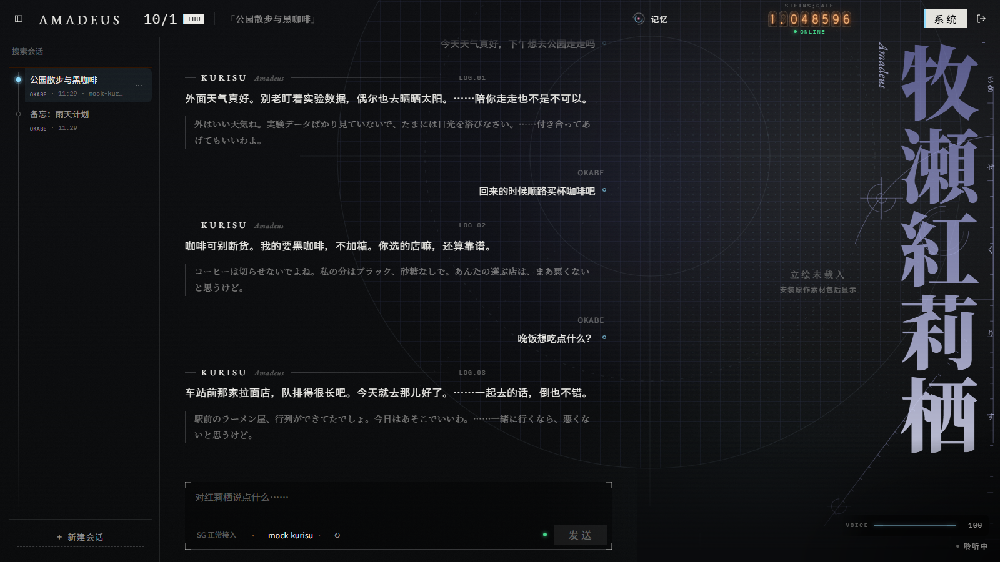
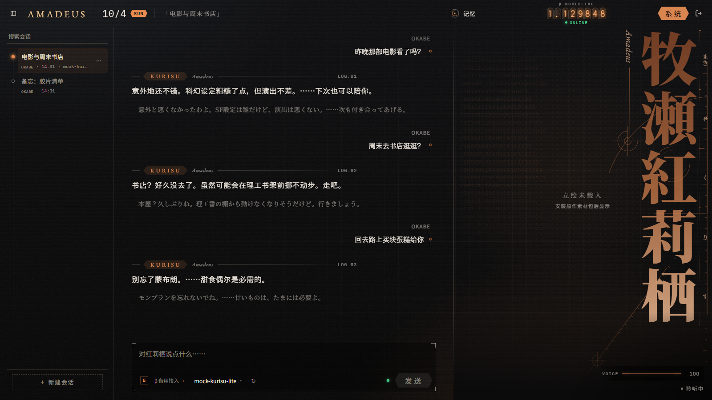
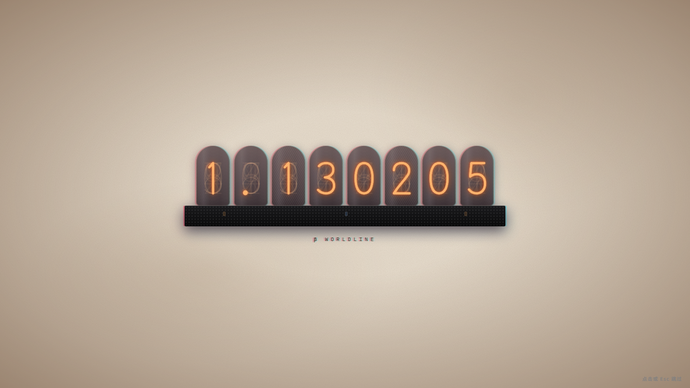
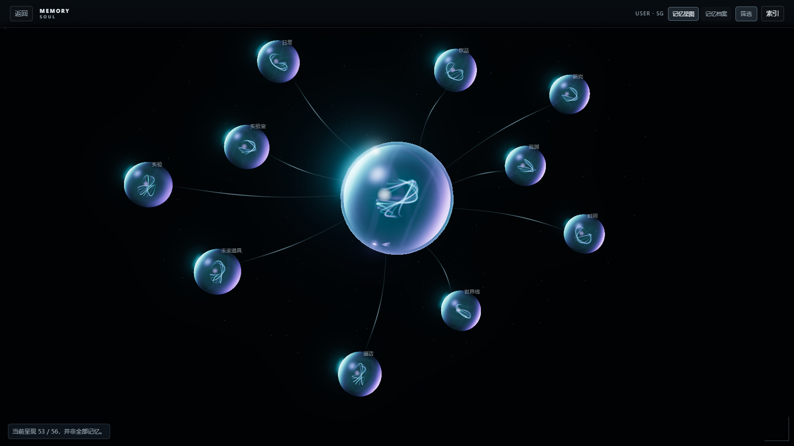
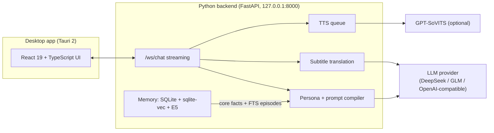

# AMADEUS

**A local-first AI companion desktop app.** Users talk with Amadeus Kurisu, who answers in Japanese with a paired subtitle for every line. Her long-term memory is stored on the user's own machine, where it can be inspected and selectively forgotten.

*Unofficial, non-commercial fan project based on STEINS;GATE. No original game assets are included.* · [中文](#中文) · [日本語](#日本語)

| | |
|---|---|
|  |  |
|  |  |

*Screenshots were taken without the optional asset pack, so the stage shows placeholder art. The worldline-shift frame is a historical capture of the WebGL2 prototype whose runtime is now integrated; the star map shows test data.*

## What it does

- **Japanese conversation with paired Chinese subtitles.** Replies stream sentence by sentence; each Japanese sentence is matched with its translation, and missing translations are marked instead of silently dropped.
- **Long-term memory that stays local.** Facts and experiences from your conversations are stored in SQLite (with `multilingual-e5-small` embeddings indexed in `sqlite-vec` on write). In the default legacy mode, core facts are injected into the prompt every turn and past episodes are retrieved by SQLite full-text search (FTS) when compiling the prompt; vector search and the `recall_memory` tool (DeepSeek only) belong to the experimental `AMADEUS_MEMORY_MODE=v11` mode and are not used by default. You can list and delete stored facts in the memory archive, optionally erase a conversation's exclusive long-term memories when clearing a chat, and view the star map (preview-only in the default mode).
- **Two isolated worldlines.** *STEINS;GATE* and *β* each have their own persona, conversations, memory and visual theme. Conversations and memories are stored separately per worldline, except for Self-mode facts explicitly promoted to the shared user profile (`/api/memory/facts/{id}/promote`, stored in `control.sqlite3`), which both worldlines read in Self mode (Okabe mode never reads or writes shared facts).
- **Worldline instruments and transitions (M3).** The header, system-menu dial and WebGL2 transition share the same cathode digits. Open **系统 → 世界线**: the dial shows the current worldline, while the diagram previews the selected target; use the shift button to begin. Softer handoffs preserve conversations and drafts, and click/Esc skips the presentation while still waiting for target confirmation.
- **Bring your own model.** DeepSeek, Zhipu GLM, or any OpenAI-compatible endpoint. Optional web search through Tavily or Firecrawl.
- **Optional voice.** Text-to-speech through a local GPT-SoVITS server; speech recognition with SenseVoice via sherpa-onnx (backend only for now, no microphone UI yet).
- **Local by design.** Every service binds to loopback, WebSocket connections are origin-checked, and API keys are stored in the Windows Credential Manager in installed builds or in memory by default in source runs. Conversation text is sent only to the model provider the user configures; if web search is enabled, search queries also go to the chosen search provider (Tavily or Firecrawl).

## Architecture



One chat turn: the UI sends the user's message over a WebSocket; in the default memory mode, the backend loads the user's core facts and full-text-matched past episodes for the active worldline and identity, compiles them into the persona prompt, and streams the model's Japanese reply in a single model call (on-demand `recall_memory` tool calls with a second model pass are used only when experimental `AMADEUS_MEMORY_MODE=v11` is enabled with DeepSeek). Each sentence is published as soon as it is complete; its subtitle and (optional) speech follow on their own ordered tracks, so a slow translation never holds back the text and may arrive after the turn has finished.

## Engineering notes

- **Measured recall behaviour.** In a controlled end-to-end run against a real model (`deepseek-flash`), 12 of 12 prompts that needed a stored fact used it, and 4 of 4 control prompts did not call the tool. That result covers that question set and environment only.
- **Windows installer.** The Tauri shell bundles the backend (PyInstaller, with the embedding model cache) into an NSIS installer, starts it on launch, refuses to start if port 8000 is taken, and shuts it down cleanly on exit. It passed a 10-item acceptance checklist on a clean English Windows Server 2022 VM: install, WebView2 bootstrap, real chat, memory write / recall / forget, restart persistence, and an uninstall that keeps user data. It is not published yet; packaging scripts are in `packaging/windows/`, and the frozen backend is a build artifact excluded from the repository.
- **Historical checks (2026-10-18).** At that point the frontend suite contained 550 cases across 48 Vitest files, including 2 known visual assertions marked as expected failures, and the production build passed. Two earlier full Vitest runs each reported 547 passes + 2 expected failures + 1 timeout in the existing `dragStress.test.tsx` (5-second limit). A subsequent full run with `npx vitest run --maxWorkers=2` passed all 48 files: 548 passes + 2 expected failures, with all tests retained and timeouts unchanged. M1 browser user testing was still pending at that checkpoint; those checks alone did not establish milestone acceptance. The backend has its own pytest suite in `backend/tests/`.
- **M3 closeout (2026-10-19).** The cloud delivery reported a passing build and 615 passes + 2 expected failures, with unit and proportionate browser checks. The developer accepted the actual Edge preview at `3723c6a6d445df102e9525bc6fad82c6fa0164fe`, merged in [`f0c18797f3ce8c178595e72f52671561f9378c23`](https://github.com/meditecnic/AMADEUS/commit/f0c18797f3ce8c178595e72f52671561f9378c23). These are prior delivery and host-acceptance results, not new test runs for this documentation update or a native GPU latency guarantee.
- **Transition startup.** The MIT-vendored [runtime](desktop/src/worldline-engine/README.vendor.md) prepares its GPU stage asynchronously ahead of a shift. Login preloads workstation fonts, remembers the faces used after entry, and uses that record on the next refresh. Existing audio initialization happens on login interaction before entry; M3 adds no audio features or runtime dependencies. See the [desktop notes](desktop/README.md) for caption and skip-hint behavior.

## How it was built

Built and maintained by one developer, who owns the product direction, architecture decisions and acceptance testing. Most of the implementation was written by AI coding agents in small batches. A second agent reviews most batches against their specification before merging; code changes are gated on the test suite, UI changes are checked with screenshots, and installer changes on a clean Windows VM.

## Status

- **Engineering MVP reached.** The Windows installer passed clean-VM acceptance; the developer's own hands-on run is in progress, and there is no public release yet.
- **M3 accepted and closed.** Worldline instruments, softer transitions and startup preparation are merged. M4 awaits authorization.
- Developed mainly on Windows; the browser dev mode also runs on Linux.
- **Planned:** English and Japanese UI. Kurisu keeps speaking Japanese in every mode; in English mode her lines get English subtitles, and in Japanese mode subtitles are turned off.

## Run it (development)

Choose between the default local mock for frontend work and a real backend for model integration. Both use the browser at http://localhost:1420.

```powershell
git clone https://github.com/meditecnic/AMADEUS.git
cd AMADEUS
```

### Local mock (default)

You only need **Node.js 22.13+** (20.19+ on 20.x also works). No Python backend, API key, model provider or TTS server is needed.

From the repository root, in PowerShell:

```powershell
cd desktop
npm ci
# Clear a previous real-backend override, if any.
Remove-Item Env:AMADEUS_DEV_MOCK -ErrorAction SilentlyContinue
npm run dev -- --port 1420 --strictPort
```

Open http://localhost:1420/?scenario=streaming. Wait for USER ID to finish typing `Salieri`, then log in with the public local test passphrase **`Gott würfelt nicht`**. Send a message to receive three scripted Japanese/Chinese sentence pairs. Session histories and Memory use synthetic fixtures; edits live in the dev server's memory and reset when it restarts. The browser retains UI preferences and the selected scenario.

The mock handles `/api`, `/ws/chat` (and `/ws`) on the same port 1420 without contacting a backend, provider or TTS server. It is a **development-only** Vite plugin (`apply: 'serve'`); its mock server and selector script are excluded from production builds and are not available in `npm run preview`.

See the [scenario catalog and switching guide](desktop/src/dev-mock/README.md), [scenario JSON files](desktop/src/dev-mock/scenarios/), and [browser evidence walkthrough](desktop/validation/README.md) for login failure, empty, offline, memory and other local checks.

### Real backend

For real conversations, also install **Python 3.11** and use an API key for a model provider. Stop the mock dev server first.

On Windows, install prerequisites before creating the virtual environment:

1. **Microsoft Visual C++ 2015–2022 Redistributable (x64)** ([download page](https://learn.microsoft.com/en-us/cpp/windows/latest-supported-vc-redist), direct [`vc_redist.x64.exe`](https://aka.ms/vs/17/release/vc_redist.x64.exe)). On a clean system without `vcruntime140_1.dll`, `pip install` and backend startup still succeed, and the failure only surfaces later during the first memory write when importing `torch` raises `WinError 1114` (`c10.dll` initialization failed).
2. **Python 3.11** ([Python 3.11.9 release page](https://www.python.org/downloads/release/python-3119/), 64-bit Windows installer [`python-3.11.9-amd64.exe`](https://www.python.org/ftp/python/3.11.9/python-3.11.9-amd64.exe) — 3.11.9 is the last 3.11 release on python.org that includes Windows binary installers).

Terminal 1, from the repository root (PowerShell — use `py -3.11` so another Python on `PATH` is not picked up silently):

```powershell
cd backend
py -3.11 --version
py -3.11 -m venv .venv
.\.venv\Scripts\python.exe -m pip install -r requirements.txt
# Use a separate development directory outside TEMP, which may be cleaned up; never select your installed app's data.
$env:AMADEUS_DATA_DIR = Join-Path $env:LOCALAPPDATA 'amadeus-dev-data'
Remove-Item Env:AMADEUS_DB_PATH -ErrorAction SilentlyContinue
.\.venv\Scripts\python.exe -m uvicorn app.main:app --host 127.0.0.1 --port 8000
```

Terminal 2, from the repository root (PowerShell — skip `npm ci` if you already ran it in Local mock):

```powershell
cd desktop
npm ci
$env:AMADEUS_DEV_MOCK = "0"
npm run dev -- --port 1420 --strictPort
```

`AMADEUS_DEV_MOCK=0` disables the mock and restores Vite's existing `/api`, `/ws` and `/health` proxies to `http://127.0.0.1:8000` (override with `AMADEUS_BACKEND_ORIGIN`). Do not use `run_dev.bat` in the repository root for real-backend runs: it starts Vite without `AMADEUS_DEV_MOCK=0`, so the UI stays on the local mock. On Linux/macOS, use `python3.11 -m venv .venv` and `.venv/bin/python` for the backend, and `AMADEUS_DEV_MOCK=0 npm run dev -- --port 1420 --strictPort` for the UI.

Before starting the backend on Linux/macOS, set a separate development directory in that terminal:

```sh
export AMADEUS_DATA_DIR="$(mktemp -d -t amadeus-dev.XXXXXXXX)"
unset AMADEUS_DB_PATH
.venv/bin/python -m uvicorn app.main:app --host 127.0.0.1 --port 8000
```

Source runs (including scripts) refuse data-directory resolution without a nonempty `AMADEUS_DATA_DIR`: `RuntimeError: AMADEUS_DATA_DIR required (non-frozen)` (exit 1). `AMADEUS_DB_PATH` still takes precedence for database files when a data directory is set; setting it alone does not bypass this check. `run_dev.bat` clears that legacy override and checks the data directory before opening either terminal; set `AMADEUS_DATA_DIR` before invoking it. A direct `uvicorn --reload` invocation can leave its parent watcher running after the backend child refuses to start. The offline snapshot builder and rehearsal CLIs keep their explicit-path isolation and do not require this variable.

Open http://localhost:1420 and log in with `Gott würfelt nicht` (the real backend normalizes case and treats `ü` / `ue` as `u`, so `gott wurfelt nicht` and `Gott wuerfelt nicht` also work here). Then open **系统 → 连接** (System → Connections) in the top-right corner; the `OpenAI-compatible · http://127.0.0.1:1234/v1 · local-model` item already listed there is the built-in default preset for a local OpenAI-compatible server. Configure your model connection and save; once the connection check passes, the conversation can start. The memory embedding model (`intfloat/multilingual-e5-small`, ~470 MB) is downloaded and loaded on the first memory write, not at backend startup. Without a voice pack, `[WARN] TTS reference audio not found ...` lines in the backend log are normal; voice remains optional (see [Voice](#voice-optional)).

The desktop window comes from the installer build; its packaging scripts are in `packaging/windows/`, and the frozen backend is a build artifact excluded from the repository; `npm run tauri -- dev` will not start from this checkout (the shell expects a bundled backend and a free port 8000). For development, use the browser at http://localhost:1420.

**Data location (real backend development):** the explicitly configured `AMADEUS_DATA_DIR`; there is no default for source runs. A frozen backend launched directly retains the `%APPDATA%\Amadeus` default on Windows (`~/.amadeus` without `APPDATA`). The Windows installer shell passes `%LOCALAPPDATA%\com.amadeus.desktop\data\` instead. Installed Windows builds store API keys in the Windows Credential Manager; source runs keep them only in memory by default, so re-enter them after each restart. To persist keys from a source run on Windows, set `AMADEUS_CREDENTIAL_BACKEND=windows`; this accesses your real Windows credentials. Other systems keep keys in memory only. The local mock does not use these backend data stores.

## Voice (optional)

Without voice, her lines simply appear as text.

- **Speech synthesis** uses [GPT-SoVITS](https://github.com/RVC-Boss/GPT-SoVITS) with the voice model [TTS-KurisuMakise](https://huggingface.co/bysq/TTS-KurisuMakise) by bysq (GPT-SoVITS v2pro, Apache-2.0). Weights and reference audio are not included. Put your own reference clips in `voice-pack/ref/` under the data directory (`ref_neutral.wav`, `ref_happy.wav`, `ref_sad.wav` and six more emotions; see `backend/app/config.py`), or point the `AMADEUS_REF_*` variables at them. Start the GPT-SoVITS API locally (default `http://127.0.0.1:9880`, override with `SOVITS_URL`) and set `SOVITS_GPT_WEIGHTS` / `SOVITS_SOVITS_WEIGHTS` to the weight files.
- **Speech recognition** downloads the SenseVoice int8 model (~163 MB) and Silero VAD (~644 KB) from the [sherpa-onnx releases](https://github.com/k2-fsa/sherpa-onnx/releases/tag/asr-models) on first use, verifies fixed SHA-256 hashes, and stores them under `models/speech/` in the data directory. Use `SENSEVOICE_MODEL`, `SENSEVOICE_TOKENS` and `AMADEUS_VAD_MODEL` to point at local copies.

**About the voice.** TTS-KurisuMakise imitates the voice of Makise Kurisu from STEINS;GATE. The character, the original recordings and the voice actor's performance belong to their respective rights holders. The Apache-2.0 label on the model page covers only what its uploader can license; it does not grant any rights to the character, the original recordings or the performance. AMADEUS does not include, download or redistribute the model or any reference audio. Use the voice for personal, non-commercial purposes only, and do not use it to impersonate the voice actor or to make content that looks official. Rights holders who want this reference removed can open a GitHub issue; we will respond promptly.

## Original asset pack

This repository contains **no** original game assets (character art, CG, logos, BGM). The app runs without them and shows its own placeholder art. If you have an asset pack, put it in `asset-pack/amadeus-original/` under the data directory (with `manifest.json` at its root) and restart the backend. The pack is distributed separately with its own notice.

## License

The code in this repository is released under the [MIT License](LICENSE). Provider icons on the connections page come from [Lobe Icons](https://github.com/lobehub/lobe-icons) (MIT); provider names and marks belong to their owners. See [third-party notices](THIRD_PARTY_NOTICES.md) for dependency licenses.

STEINS;GATE, STEINS;GATE 0 and their characters, names and original assets belong to MAGES. Inc. and the respective rights holders. This repository does not include those assets and the project is not used for any commercial purpose. If a rights holder asks, we will act on it promptly.

---

## 中文

一个可以在自己电脑上和牧濑红莉栖说话的桌面应用。

她使用日语回答，屏幕上同时有中文字幕。她会记住你们聊过的事，能看得见，也能让她忘掉。（Amadeus 的人格设定基本上就是参考官方小说和相关资料）本项目共有两条世界线：**STEINS;GATE** 和 **β**。两边的对话、记忆互不相通，界面也各是各的样子。（sg 线相当于是架空的，在现实中红莉栖还活着的情况下，诞生的 Amadeus；加了些设定，你在 sg 线提到真实红莉栖，Amadeus 还会争风吃醋。）

这是一个粉丝作品，和官方没有任何关系。

### 现在做到哪了

从 6 月中旬起已经开发了大约四个月。

**新界面的 Windows 安装包已经打出来了**，在一台干净的英文 Windows Server 2022 虚拟机上，10 项验收全部通过：安装、自动装 WebView2、真实对话、记忆的写入/召回/遗忘、重启后还记得、卸载时保留数据。我自己再完整体验一轮，就放出来。（打包脚本在 `packaging/windows/`，冻结后端是构建产物，不进仓库。）

已经能用的：

- 和她用日语多轮对话，中文字幕逐句跟上
- 长期记忆：她记住了什么随时能查，不想让她记得的可以让她忘掉（记忆星图还在打磨，现在先在档案页里看）
- 在 SG 和 β 两条世界线之间跃迁，各自保留会话和草稿
- M3 已接受并合并：右上角、系统菜单与跃迁演出统一阴极数字；「系统 → 世界线」的仪器显示当前线，图中预览目标，再按跃迁按钮。过渡更柔和，点击／Esc 可跳过演出，仍须等待目标确认。GPU 与字体提前异步预热；字体使用记录在下次刷新后用于预加载，既有音频初始化移到入场前，没有新增音频功能。
- 接入你自己的大模型：DeepSeek、智谱 GLM，或任何兼容 OpenAI 接口的服务
- 可选的联网搜索（Tavily、Firecrawl）
- 用红莉栖的声音念出她的回答（需要另外跑 GPT-SoVITS，见上文 [Voice](#voice-optional)）

M3 已收尾，M4 等待授权。英文和日文界面仍在计划中；她始终说日语，英文界面下配英文字幕，日文界面下就不再显示字幕了。

正常 GPU 演出不显示状态字幕，但保留读屏状态；等待超过 0.7 秒才显示提示，失败立即显示。提示采用无底框琥珀字幕，失败使用错误色；Esc 提示在活动、键盘聚焦及前 3 次引导时出现。减少动态与降级路径仍保留同一切换事务，跳过不会伪造成功。验证来源和边界见上文 [Engineering notes](#engineering-notes)。

### 运行

开发有两种模式，命令见上文 [Run it](#run-it-development)。安装和运行以英文版为准。Windows 和 Linux 都能跑。

**默认本地 mock**：只需 Node.js，不用启动 Python 后端，不需要 API 密钥、真实模型或 TTS。按 [Local mock](#local-mock-default) 执行 `npm ci` 和 `npm run dev -- --port 1420 --strictPort`，打开 http://localhost:1420/?scenario=streaming 。等 USER ID 自动输入完 `Salieri` 后，用公开本地测试口令 `Gott würfelt nicht` 登录；发送任意消息即可看到三组逐句到达的日语和中文字幕。会话和记忆都是测试数据，服务重启后重置。mock 仅用于开发，不进入生产构建，`npm run preview` 也不提供 mock。

其他状态见 [场景目录与切换说明](desktop/src/dev-mock/README.md) 和 [场景 JSON](desktop/src/dev-mock/scenarios/)；双世界线与减少动态的走查见 [浏览器证据指南](desktop/validation/README.md)。

**真实后端**：按 [Real backend](#real-backend) 先启动 `uvicorn app.main:app`，再在前端终端用 PowerShell 设置 `$env:AMADEUS_DEV_MOCK = "0"`，然后启动 Vite。登录口令仍是 `Gott würfelt nicht`。进去以后，从右上角的「系统」打开「连接」，配置自己的模型连接并保存。连接测试通过后，就可以开始说话了。第一次写入记忆时会下载记忆功能要用的模型；语音是可选项。

真实后端开发模式下，必须先显式设置 `AMADEUS_DATA_DIR` 到独立开发目录（Windows：`$env:AMADEUS_DATA_DIR = Join-Path $env:LOCALAPPDATA 'amadeus-dev-data'`，即 `%LOCALAPPDATA%\amadeus-dev-data`，避免被 TEMP 清理），并清除 `AMADEUS_DB_PATH`；未设置或为空时拒绝启动，不再默认使用用户目录。单设 `AMADEUS_DB_PATH` 不能绕过检查。安装版仍放在 `%LOCALAPPDATA%\com.amadeus.desktop\data\`；单独运行冻结后端仍默认用 `%APPDATA%\Amadeus`（无 `APPDATA` 时用 `~/.amadeus`）。Windows 安装版把 API key 存进 Windows 凭据管理器；源码运行默认只存内存，重启后要重新输入。若要在 Windows 源码运行时持久保存 key，设置 `AMADEUS_CREDENTIAL_BACKEND=windows`；这会访问你的真实 Windows 凭据。其他系统只存内存。所有服务只监听本机地址，你的对话只会发给你自己配置的那个模型服务；如果开启联网搜索，搜索词还会发给你配置的搜索服务（Tavily 或 Firecrawl）。本地 mock 不使用这些后端数据目录，也不调用模型或语音服务。

### 原作素材包

本仓库**不包含**任何原作素材，比如立绘、CG、Logo、BGM。没有素材包也能正常使用，界面会换成自制画面。（版权问题，目前的解法就只能是素材包了）

### 语音

语音合成是可选功能，通过本机的 GPT-SoVITS 服务完成。声音模型是 Hugging Face 上 bysq 训练的 [TTS-KurisuMakise](https://huggingface.co/bysq/TTS-KurisuMakise)。本仓库不附带、不下载、也不转发模型权重和参考音频，需要你自己准备。

这个声音模仿的是《命运石之门》里的牧濑红莉栖。角色、原作录音和声优的表演归各自的权利人所有。模型页上的 Apache-2.0 只覆盖上传者自己能授权的部分，不代表获得了角色、原作录音或表演的授权。请只在个人、非商业场景使用，不要用它冒充声优，也不要制作看起来像官方的内容。权利人如需移除相关内容，请在 GitHub 提 issue，我们会尽快处理。

语音识别的后端已经有了，前端页面还没做。

### 个人的碎碎念吧

因为一直是个人开发，中途的困难挫折也有很多，目前最棘手的应该就是版权问题了。之前说尽量在 1 个月左右推送首个 MVP 安装包——安装包已经打好、过了工程验收，等我自己完整体验一轮就放出来。

okeydokey，大概就是这些，那么来句帅气的收尾吧：El Psy Kongroo.

---

## 日本語

> *世界線変動率 1.048596%――Amadeus システム、起動。*

自分の PC の中で、牧瀬紅莉栖と話せるデスクトップアプリだ。

彼女は日本語で答える。交わした言葉の記憶は、機関の目が届かないあなたの PC の中だけに刻まれる。何を覚えているかはいつでも覗けるし、会話ごと忘れさせることもできる。世界線は **STEINS;GATE** と **β** の二つ。会話も記憶も、決して交わらない。（SG 世界線のアマデウスは、オリジナルの紅莉栖が生きている世界で生まれた。本人の話をすると……少し妬くかもしれない）

- 日本語での会話（中国語字幕つき。英語・日本語 UI は開発予定。彼女はどのモードでも日本語で話す――英語モードでは英語字幕、日本語モードでは字幕なし）
- ローカル長期記憶：SQLite + sqlite-vec + multilingual-e5-small。標準モードでは毎ターン核となる事実をプロンプトに入れ、過去の出来事は全文検索（FTS）で引く（必要なときだけモデルが `recall_memory` ツールで思い出すのは実験的な `AMADEUS_MEMORY_MODE=v11` のみ）
- DeepSeek、Zhipu GLM、OpenAI 互換 API（ローカルモデルを含む）に対応
- 音声合成（GPT-SoVITS）は任意
- M3 は実機 Edge プレビューで承認され、統合済み。ヘッダー・システムメニュー・遷移演出の陰極数字を統一。「系统 → 世界线」では計器に現在の世界線、図に選択した移動先を表示し、ボタンで遷移する。クリック／Esc で演出を省略しても、移動先の確認を待つ。

この音声は『STEINS;GATE』の牧瀬紅莉栖の声を模倣したものです。キャラクター、原作の録音、声優の実演に関する権利は、それぞれの権利者に帰属します。モデルページの Apache-2.0 は、アップロードした本人が許諾できる範囲にのみ適用され、キャラクター、原作の録音、実演に関する権利の許諾を意味するものではありません。個人かつ非商用の用途に限って使用し、声優へのなりすましや、公式と誤認されるようなコンテンツの制作には使わないでください。権利者の方が関連内容の削除を希望される場合は、GitHub で issue を作成してください。速やかに対応します。

遷移の受け渡しを柔らかくし、GPU を非同期で準備する。ログイン画面ではフォントを先読みし、入場後の使用記録を次回の再読み込みに使う。既存の音声初期化は入場前に移した。通常の GPU 演出中は状態字幕を隠して読み上げ用の状態を保ち、0.7 秒を超える待機や失敗時に表示する。字幕は背景枠のない琥珀色（失敗時はエラー色）。Esc の案内は操作・フォーカス・最初の 3 回の案内時に現れる。検証結果の出典と範囲は [Engineering notes](#engineering-notes) を参照。M3 は完了し、M4 は承認待ち。

開発時の起動方法は [Run it](#run-it-development) を参照。セットアップと実行手順は英語版を正とする。**標準はローカル mock** で、Node.js だけで動き、Python バックエンド、API キー、実際のモデルや TTS は不要。[Local mock](#local-mock-default) の手順で `npm ci` と `npm run dev -- --port 1420 --strictPort` を実行し、http://localhost:1420/?scenario=streaming を開く。USER ID が `Salieri` と入力されるまで待ち、公開のローカルテスト用合言葉 `Gott würfelt nicht` でログインする。メッセージを送ると、日本語と中国語字幕の組が三つ、順番に届く。会話と記憶はテストデータで、開発サーバーの再起動でリセットされる。mock は開発専用で、製品ビルドには含まれず、`npm run preview` でも利用できない。

利用できる状態は [シナリオ一覧と切り替え方法](desktop/src/dev-mock/README.md) と [JSON ファイル](desktop/src/dev-mock/scenarios/)、確認手順は [ブラウザー検証ガイド](desktop/validation/README.md) を参照。

**実際のバックエンドを使う場合**は [Real backend](#real-backend) に従って Python サーバーを起動し、フロントエンド側の PowerShell で `$env:AMADEUS_DEV_MOCK = "0"` を設定してから Vite を起動する。合言葉は同じ `Gott würfelt nicht`――神はサイコロを振らない。ログイン後、右上の「系统 → 连接」で自分のモデル接続を設定する。初回の記憶書き込み時に記憶用の埋め込みモデルがダウンロードされる。音声は任意。

非公式・非営利のファン作品。原作素材は一切含まない。STEINS;GATE の権利は MAGES. Inc. および各権利者に帰属する。

*El Psy Kongroo.*
