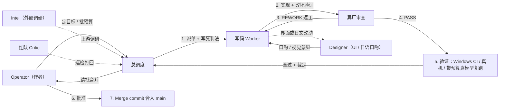

# AMADEUS 是怎么用多厂商 Agent 协作做出来的

AMADEUS 是一个个人开发的 Windows 桌面应用（Tauri 2 + React 19 + FastAPI + 本地长期记忆）。整个项目由我一个人当 operator，带着多家厂商的模型（OpenAI、Anthropic、Google 等），拆角色、立规矩、靠独立审查和真机验收，推到了 v0.1.0 发布前。PR 和提交标题里到处可见的 `[NNN]`（如 `[310]`、`[320]`），是私有协作仓的派单号，用来串联派单、审查、返工和裁定。

这不是「把需求丢给 AI 全自动写完」，更像一个人带一支不会累但会犯蠢的小队：模型负责写码、写探针、跑测试，方向取舍、合并门禁、预算审批和最终体验全部由人拍板。

## 可以点开核对的数字（截至 2026-11-24）

- **已合 PR**：**102 个**（`#1`–`#106` 中已合 102 个，见 [Merged PRs](https://github.com/meditecnic/AMADEUS/pulls?q=is%3Apr+is%3Amerged)）。
- **跨厂审查**：2026-11-17 起在合并提交显式标模型名，`#82`–`#106`（`#102` 为未合 Draft）连续 **24/24 个已合 PR** 均在 `main` merge commit 写明作者与异厂审查模型，见 [main 提交历史](https://github.com/meditecnic/AMADEUS/commits/main)（早期 `#5`、`#7`、`#12` 等也有交叉审码）。
- **CI 矩阵（6 个 job）**：见 [`.github/workflows/ci.yml`](../../.github/workflows/ci.yml)——Ubuntu 跑 `lint`、`backend-lock`、`eol`；Windows 跑 `frontend`（Node 22 + Vitest）、`backend`（py3.11，中文空格临时路径 + `cp1252`）、`backend-py313`。另有 [`.github/workflows/release.yml`](../../.github/workflows/release.yml) 跑安装包与干净 Windows `install_smoke.py`。
- **测试规模**：2026-11-24 `main` [`715b9a3`](https://github.com/meditecnic/AMADEUS/commit/715b9a3fa0bca16f3116645db6e61b9a3ce9e50f) 的 [CI 运行记录](https://github.com/meditecnic/AMADEUS/actions/runs/45341281793)：后端 **3,965 条**（3,961 passed, 2 skipped, 2 xfailed，py3.11/3.13 双绿），前端 **1,036 条**（全过）。

## 角色与一张单的流程

## 几条让它转得动的规矩

1. **写和审必须不同厂商**。同家模型容易共享盲区，Google、Anthropic、OpenAI 绝不互审；高风险包派两家盲审。
2. **判法在看结果之前写死**。评测或真模型复跑发单前先把通过标准写死，防止拿结果后凑理由放水。
3. **真实模型调用有预算上限**。单测走离线桩，真花钱须先批预算，脚本设硬预算闸，到线即停。
4. **只用 merge commit，提交标题写模型名**。禁 squash/rebase，保留 `.git-blame-ignore-revs` 和完整返工链，方便对比模型表现。
5. **密钥和隐私在暂存前扫**。公开仓历史永久，密钥、个人邮箱、本机路径进提交前先过脚本拦截。
6. **Worker 只在新建 worktree 里动**。主树不动，每单开独立 worktree 用完即删，并行互不踩脏。

## 人和模型各做了什么

- **我（Operator）**：定方向和边界、批合并与预算、亲签所有最终日文文案、做盲聊与 Windows 实机验收。
- **总调度**：拆包、写派单与判法、收报告裁定、核 PR 与 CI，不写产品代码。
- **写码 Worker**：在独立 worktree 写代码与测试，并做改坏验证。
- **异厂审查 / Designer / Critic / Intel**：审查写探针抓漏网硬伤；Designer 管视觉与日语口吻；Critic 红队巡检盯系统盲区；Intel 查上游文档与依赖。

## 真实案例

每个案例均附公开 PR、提交与 CI 链接；私有协作仓内部记录均单独注明。

- [PR #106：CI 偶发 `CancelledError`，从「复现不了」到公开更正并根治](cases/pr-106-py313-teardown-cancel.md)（2026-11-24）
- [PR #101：CI 全绿后，两家异厂审查盲审撞出同一个静默丢回复 bug](cases/pr-101-dual-review-same-bug.md)（2026-11-22）
- [PR #107：日语护栏重写器，¥0.051 真模型复跑与先写死判法](cases/pr-107-renderer-real-replay.md)（2026-11-24，Draft 未合）
- [PR #104：单测与 CI 全绿后，Windows 真机实跑抓出播放中截断 409 竞态](cases/pr-104-windows-real-run-race.md)（2026-11-23）

## 协作样板（摘录自私有协作仓，已脱敏）

- [审查派单（`[321]` 审查 PR #107）](templates/dispatch-review-example.md)
- [异厂审查报告（`[321]` REWORK）](templates/review-report-example.md)
- [先写死判法的裁定（`[322]` 判法与判定表）](templates/rubric-and-verdict-example.md)
